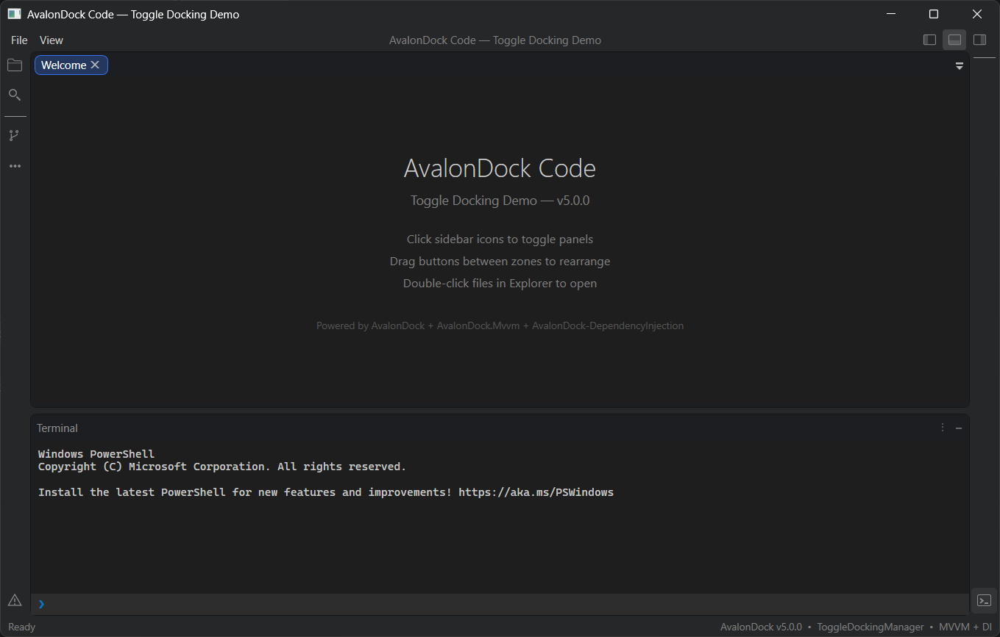
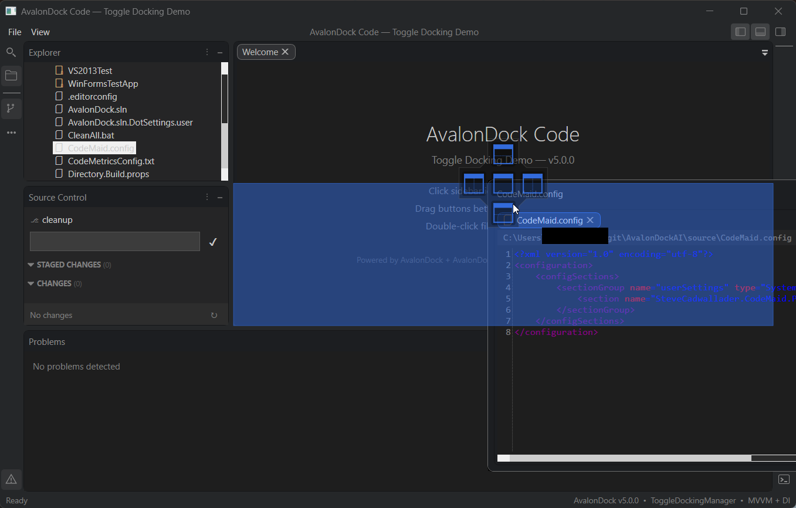
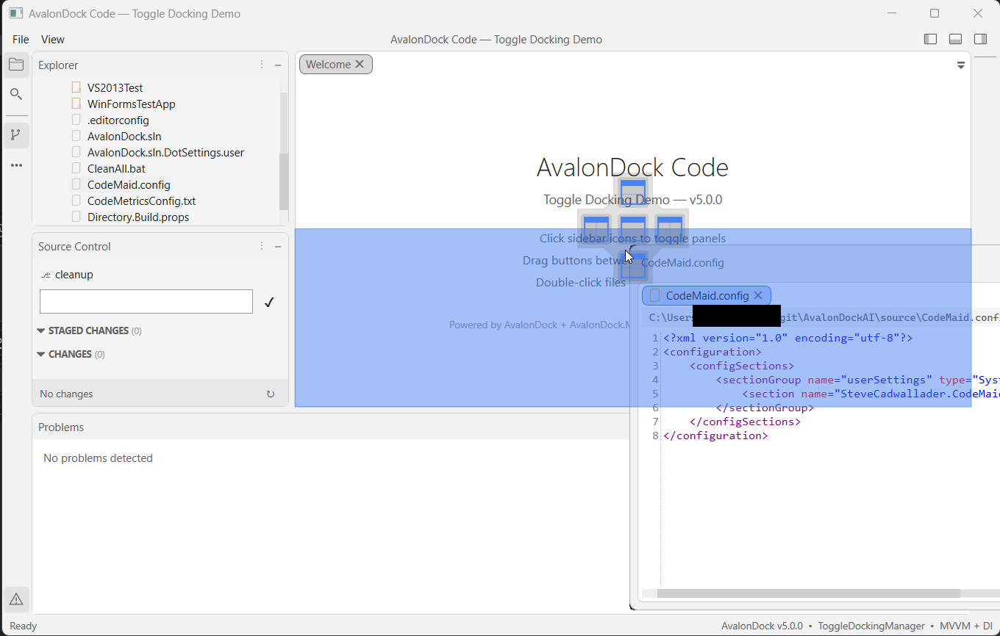
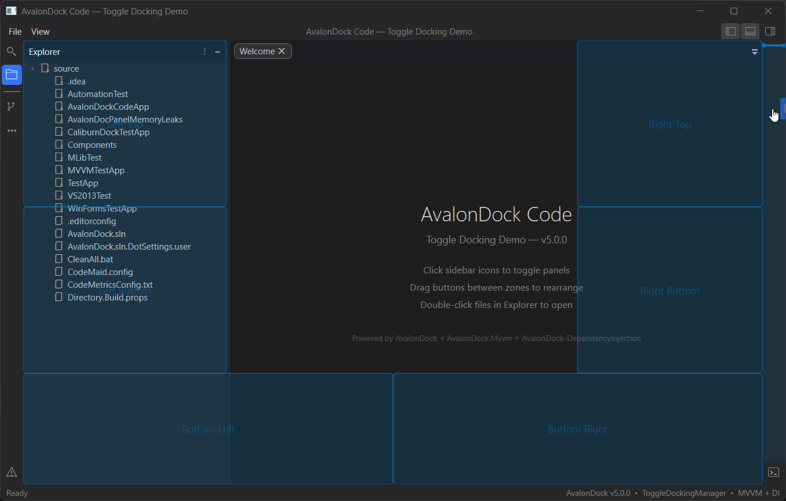
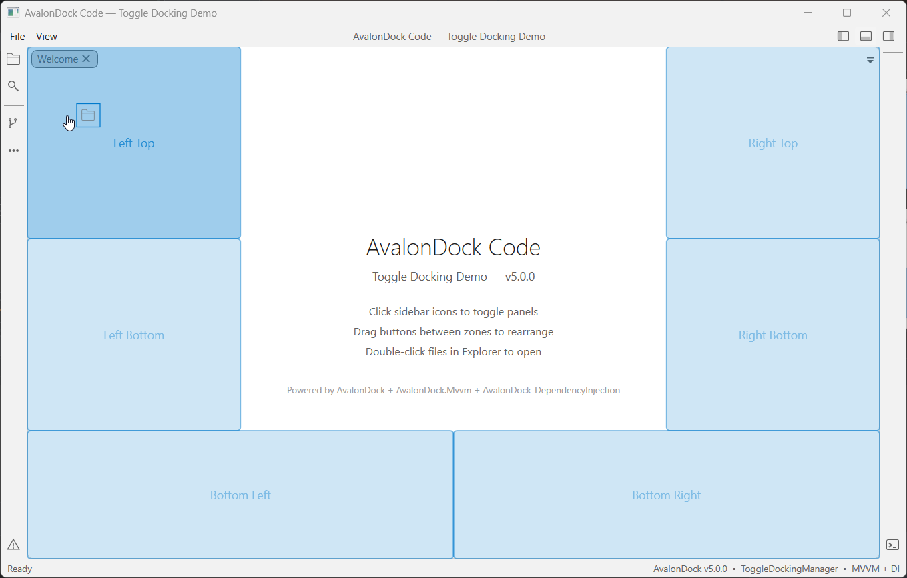
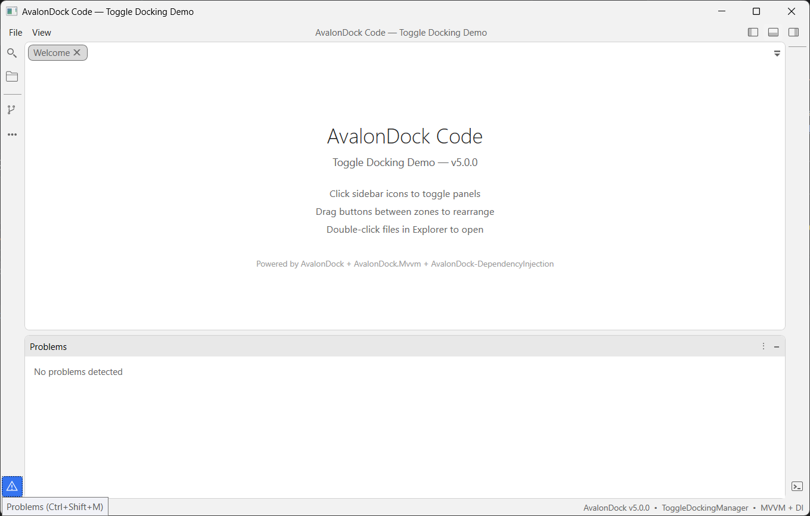
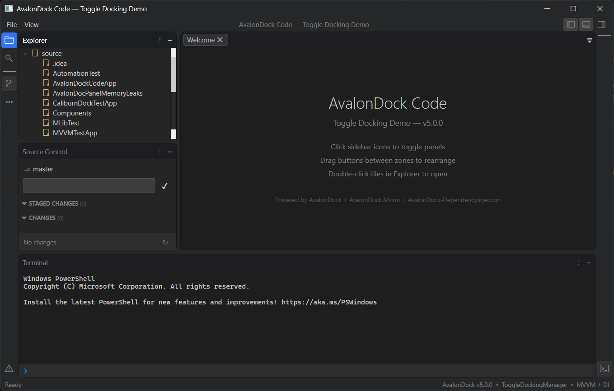
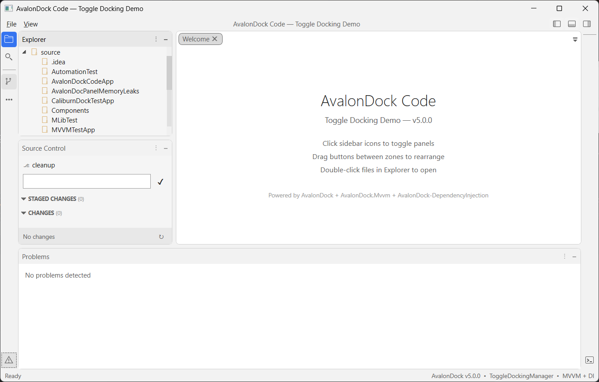

# AvalonDock (NTLDR2 Fork)

    [](LICENSE)

AvalonDock is a WPF Document and Tool Window docking layout container used to arrange tabbed documents, split panes, floating windows, and auto-hidden or sidebar-toggled tool windows—powering IDE-style workspaces similar to Visual Studio, JetBrains Rider, Eclipse, and VS Code.

> [!NOTE]
> **Upstream Attribution:** This repository ([NTLDR2/AvalonDock](https://github.com/NTLDR2/AvalonDock)) is a specialized fork of **[Dirkster99/AvalonDock](https://github.com/Dirkster99/AvalonDock)** (`v5.1.0`), building on Dirkster99's modular v5 architecture (first-class MVVM, `IServiceCollection` dependency injection, `ToggleDockingManager`, DTO persistence, and modern theming).

Across the broader ecosystem, AvalonDock powers [many open-source and commercial applications](https://github.com/search?p=4&q=%22dirkster.avalondock%22&type=Code), including [Stride](https://github.com/stride3d/stride), [Optick](https://github.com/bombomby/optick), [RoslynPad](https://github.com/roslynpad/roslynpad), [WpfDesigner](https://github.com/icsharpcode/WpfDesigner), [DaxStudio](https://github.com/DaxStudio/DaxStudio), [Macad3D](https://github.com/Macad3D/Macad3D), [Edi](https://dirkster99.github.io/Edi/), and Microsoft's [Profile Explorer](https://github.com/microsoft/profile-explorer).

---

## Fork Philosophy, Mission & Goals

This fork ([NTLDR2/AvalonDock](https://github.com/NTLDR2/AvalonDock)) refines [Dirkster99/AvalonDock](https://github.com/Dirkster99/AvalonDock) for long-lived Windows desktop applications that require deterministic assembly loading, zero transitive binding-redirect surprises, and crystal-clear architectural documentation.

**Vision:** Deliver a rock-solid, zero-drama WPF docking engine that compiles cleanly from source, runs reliably from Windows 7 SP1 64-bit through Windows 11, and gives both human developers and AI coding agents complete visibility into every engine invariant.

**Mission & Core Goals:**

- **Eliminate `System.Text.Json` DLL Hell:** Never reference or transitively import `System.Text.Json`. On `.NET Framework 4.8`, `System.Text.Json` drags in out-of-band `System.Memory`, `System.Buffers`, `System.Runtime.CompilerServices.Unsafe`, and `Microsoft.Bcl.AsyncInterfaces` packages—a notorious source of runtime `FileLoadException` binding-redirect conflicts in complex desktop hosts. `Serializer.Json` has been omitted in favor of inbox XML DTO persistence, and `Themes.VS` (`VsJsonThemeParser`) + `Themes.VS2013` have been refactored to pure zero-dependency C#.
- **Target `.NET Framework 4.8` & WPF Strictly:** Target `net48` exclusively across all WPF controls, themes, samples, and automated test suites—never treating `.NET Framework 4.8` as an afterthought—paired with `netstandard2.0` UI-agnostic contracts (`Core`, `Mvvm*`, `DependencyInjection`, `Serializer.Xml`).
- **Vendored Docking Dependency for SomaFrameQD:** Maintain a self-contained, warning-free (`--warnaserror`) component tree engineered to serve as the vendored docking engine inside [NTLDR2/SomaFrameQD](https://github.com/NTLDR2/SomaFrameQD).
- **Caliburn.Micro MVVM Comfort:** Provide the modernized [ExperimentalTestApp](source/ExperimentalTestApp/README.md) reference sample (`Caliburn.Micro 6.0.15-beta` + classic `DockingManager`, documented in [Caliburn.Micro Integration](documentation/guides/caliburn-micro.md)) and plan an optional **Caliburn.Micro** Base Class Library (`AvalonDock.Mvvm.CaliburnMicro`), guided by [NTLDR2/Caliburn.Micro](https://github.com/NTLDR2/Caliburn.Micro) and detailed in [ROADMAP.md](ROADMAP.md).
- **Inside-Out Documentation for AI Agents & Engineers:** Ship a complete 41-page v5 documentation suite ([documentation/](documentation/index.md)), always-loaded agent guardrails ([AGENTS.md](AGENTS.md)), and a deep engine-invariants reference ([SKILL.md](.agents/skills/avalondock-internals/SKILL.md)) so AI coding agents produce accurate v5 code without legacy v4 hallucinations.

---

## Quick Start & Technical Differences from Upstream

### How This Fork Differs from `Dirkster99/AvalonDock`

Before installing or migrating code from upstream tutorials, note the deliberate architectural differences in `NTLDR2/AvalonDock`:

| Area | Upstream (`Dirkster99/AvalonDock`) | This Fork (`NTLDR2/AvalonDock`) |
|:-----|:-----------------------------------|:--------------------------------|
| **Shipped Libraries** | 14 packages | **13 packages** — `Dirkster.AvalonDock.Serializer.Json` (and `VS2013Test`) is **permanently omitted**; `Themes.VS` and `Themes.VS2013` are refactored to zero `System.Text.Json` |
| **`System.Text.Json` Policy** | Used by JSON serializer and VS2026 JSON theme parser | **Zero `System.Text.Json` anywhere** across all library, sample, and test projects to prevent `net48` DLL hell |
| **Layout Persistence** | XML (`Serializer.Xml`) + JSON (`Serializer.Json`) | **XML DTO persistence (`AvalonDock.Serializer.Xml`)** using inbox `System.Xml.Serialization` (backward-compatible with v4 XML) + `LayoutSerializerBase` for custom formats |
| **Available Themes** | `Arc`, `VS` (2015/2022/2026), `VS2013`, `VS2010`, `Expression`, `Metro`, `Aero`, `Generic` | **All 7 theme packages (`Arc`, `VS` [2015/2022/2026], `VS2013`, `VS2010`, `Expression`, `Metro`, `Aero`) + `GenericTheme`** (20 built-in themes, all zero-dependency on `net48`) |
| **Primary Runtime Focus** | Modern `.NET` + `net48` published via `nuget.org` | **Strict `.NET Framework 4.8` (`net48`) + WPF** (plus `netstandard2.0` UI-agnostic packages), built from source / local NuGet pack / vendored directly (targeting [SomaFrameQD](https://github.com/NTLDR2/SomaFrameQD)) |
| **Package & Brand Identity** | `Dirkster.AvalonDock*` on `nuget.org` | Retains `Dirkster.AvalonDock*` assembly/package names temporarily for vendored compatibility; **planned rebrand to `AvalonDox`** ([ROADMAP.md](ROADMAP.md)) prior to any standalone NuGet publishing |
| **Documentation & AI Tooling** | Docs site & GitHub Wiki | **41-page [documentation/](documentation/index.md) site** + **[AGENTS.md](AGENTS.md)** + **[avalondock-internals SKILL.md](.agents/skills/avalondock-internals/SKILL.md)** + **[ROADMAP.md](ROADMAP.md)** |

### Step 1: Consume This Fork (Vendored Source or Local NuGet Feed)

Because this fork removes upstream `System.Text.Json` dependencies and targets vendored/source integration, consume it by referencing the projects under `source/Components/` (submodule, subtree, or vendored folder) or packing local `.nupkg` artifacts:

```powershell
# Clone this fork (or add as a submodule in your host repository)
git clone https://github.com/NTLDR2/AvalonDock.git
cd AvalonDock

# Build all 13 libraries (net48 + netstandard2.0)
dotnet restore source/AvalonDock.sln
dotnet build source/AvalonDock.sln --configuration Release --no-restore --warnaserror

# Optional: pack clean local NuGet packages into ./artifacts/nupkgs
dotnet pack source/AvalonDock.sln --configuration Release --no-build --output ./artifacts/nupkgs
```

In a `.NET Framework 4.8` (`net48`) WPF host project, reference only the modules your app needs:

```xml
<!-- Direct vendored ProjectReference example (net48 WPF + netstandard2.0 core/MVVM/XML) -->
<ItemGroup>
  <ProjectReference Include="..\vendor\AvalonDock\source\Components\AvalonDock\AvalonDock.csproj" />
  <ProjectReference Include="..\vendor\AvalonDock\source\Components\AvalonDock.Core\AvalonDock.Core.csproj" />
  <ProjectReference Include="..\vendor\AvalonDock\source\Components\AvalonDock.Mvvm\AvalonDock.Mvvm.csproj" />
  <ProjectReference Include="..\vendor\AvalonDock\source\Components\AvalonDock.Serializer.Xml\AvalonDock.Serializer.Xml.csproj" />
  <ProjectReference Include="..\vendor\AvalonDock\source\Components\AvalonDock.Themes.Arc\AvalonDock.Themes.Arc.csproj" />
</ItemGroup>
```

*(If consuming from a local NuGet feed, the package IDs remain `Dirkster.AvalonDock`, `Dirkster.AvalonDock.Core`, `Dirkster.AvalonDock.Mvvm`, `Dirkster.AvalonDock.Mvvm.CommunityToolkit`, `Dirkster.AvalonDock.DependencyInjection`, `Dirkster.AvalonDock.Serializer.Xml`, and `Dirkster.AvalonDock.Themes.{Arc,VS,VS2013,VS2010,Expression,Metro,Aero}`.)*

### Step 2: Declare a Docking Layout in XAML

The XAML namespace URI (`https://github.com/Dirkster99/AvalonDock`) is preserved for full compatibility with existing XAML views:

```xml
<Window x:Class="MyDockingApp.MainWindow"
        xmlns="http://schemas.microsoft.com/winfx/2006/xaml/presentation"
        xmlns:x="http://schemas.microsoft.com/winfx/2006/xaml"
        xmlns:avalonDock="https://github.com/Dirkster99/AvalonDock"
        xmlns:themes="clr-namespace:AvalonDock.Themes;assembly=AvalonDock.Themes.Arc"
        Title="My WPF Docking Workspace" Height="600" Width="960">

    <avalonDock:DockingManager x:Name="dockManager">
        <avalonDock:DockingManager.Theme>
            <themes:ArcDarkTheme />
        </avalonDock:DockingManager.Theme>

        <avalonDock:LayoutRoot>
            <avalonDock:LayoutPanel Orientation="Horizontal">
                <!-- Left Docked Tool Window -->
                <avalonDock:LayoutAnchorablePane DockWidth="240">
                    <avalonDock:LayoutAnchorable Title="Explorer"
                                                  ContentId="explorer"
                                                  CanClose="False">
                        <TextBlock Text="Solution Explorer" Margin="8" />
                    </avalonDock:LayoutAnchorable>
                </avalonDock:LayoutAnchorablePane>

                <!-- Center Tabbed Document Area -->
                <avalonDock:LayoutDocumentPane>
                    <avalonDock:LayoutDocument Title="Welcome.md" ContentId="welcome">
                        <TextBox AcceptsReturn="True"
                                 FontFamily="Consolas"
                                 Text="Ready on .NET Framework 4.8!" />
                    </avalonDock:LayoutDocument>
                </avalonDock:LayoutDocumentPane>
            </avalonDock:LayoutPanel>
        </avalonDock:LayoutRoot>
    </avalonDock:DockingManager>
</Window>
```

### Step 3: Save & Restore Layouts via XML (Zero External Dependencies)

In v5, layout persistence lives in `AvalonDock.Serializer.Xml` (`using AvalonDock.Serializer.Xml;`) and maps `LayoutRoot` through plain DTOs (`AvalonDock.Core.Serialization.Dto`), maintaining backward compatibility with v4 XML layout files:

```csharp
using System.IO;
using AvalonDock.Serializer.Xml;

// Save layout
new XmlLayoutSerializer(dockManager).Serialize("layout.xml");

// Restore layout
if (File.Exists("layout.xml"))
{
    var serializer = new XmlLayoutSerializer(dockManager);
    serializer.LayoutSerializationCallback += (_, args) =>
    {
        // args.Model is UI-agnostic ISerializableLayoutContent; unresolved items are removed by default
        if (args.Model.ContentId == "explorer")
        {
            args.Content = myExplorerViewOrViewModel;
        }
    };
    serializer.Deserialize("layout.xml");
}
```

For the full walkthrough, see [Quick Start](documentation/getting-started/quick-start.md) and [Layout Serialization](documentation/guides/serialization.md).

---

## Modular Component Packages (13 Libraries)

All 13 libraries ship with embedded XML IntelliSense documentation (`CS1591` enforced under `--warnaserror`) and strong-name assembly signing.

### Core, MVVM & Dependency Injection

| Project / Package ID | Target Frameworks | Description |
|:---------------------|:------------------|:------------|
| `Dirkster.AvalonDock` | `net48` | Core WPF docking controls (`DockingManager`, `ToggleDockingManager`, layout model, floating & detached windows, `GenericTheme`) |
| `Dirkster.AvalonDock.Core` | `netstandard2.0` | UI-agnostic interfaces (`IDockable`, `IRootDock`, `IToolbox`, `IDockLayoutService`), enums, and 17 serialization DTOs — zero WPF or external dependencies |
| `Dirkster.AvalonDock.Mvvm` | `netstandard2.0` | Ready-to-use MVVM base classes (`DockableBase`, `ToolboxBase`, `Document`, `Tool`, `DockLayoutService`, `SideToggleManager`) — **zero external dependencies** |
| `Dirkster.AvalonDock.Mvvm.CommunityToolkit` | `netstandard2.0` | Optional `CommunityToolkit.Mvvm` (`ObservableObject`) base classes (`ObservableDockableBase`, `ObservableToolboxBase`, `ObservableDocument`, `ObservableTool`) supporting `[ObservableProperty]` and `[RelayCommand]` |
| `Dirkster.AvalonDock.DependencyInjection` | `netstandard2.0` | `IServiceCollection` registration extensions (`AddDockLayoutService`, `DockLayoutBuilder`, `DockingOptions`, `ToggleDockOptions`) |

> [!TIP]
> **Using Caliburn.Micro?** See the modernized [ExperimentalTestApp](source/ExperimentalTestApp/README.md) reference sample (`Caliburn.Micro 6.0.15-beta` + classic `DockingManager`) and [Caliburn.Micro Integration](documentation/guides/caliburn-micro.md); an optional dedicated BCL (`AvalonDock.Mvvm.CaliburnMicro`) paired with [NTLDR2/Caliburn.Micro](https://github.com/NTLDR2/Caliburn.Micro) is detailed in [ROADMAP.md](ROADMAP.md).

### Layout Serializer

| Project / Package ID | Target Frameworks | Description |
|:---------------------|:------------------|:------------|
| `Dirkster.AvalonDock.Serializer.Xml` | `netstandard2.0` | XML layout serializer (`XmlLayoutSerializer`) backed by inbox `System.Xml.Serialization` with v4 XML layout compatibility — **zero external dependencies** |

### Themes

| Project / Package ID | Target Frameworks | Variants & Style |
|:---------------------|:------------------|:-----------------|
| `Dirkster.AvalonDock.Themes.Arc` | `net48` | `ArcDarkTheme`, `ArcLightTheme` — modern compact IDE theme with rounded tabs |
| `Dirkster.AvalonDock.Themes.VS` | `net48` | `VS2026{Dark,Light,Blue}Theme`, `VS2022{Dark,Light,Blue}Theme`, `VS2015{Dark,Light,Blue}Theme`, plus `VsTheme` (`.vstheme` / `.vstheme.gz` / pure-C# VS2026 JSON) in `AvalonDock.Themes.VS` |
| `Dirkster.AvalonDock.Themes.VS2013` | `net48` | `Vs2013DarkTheme`, `Vs2013LightTheme`, `Vs2013BlueTheme` — flat Visual Studio 2013 themes |
| `Dirkster.AvalonDock.Themes.VS2010` | `net48` | `VS2010Theme` — classic Visual Studio 2010 gradient docking theme |
| `Dirkster.AvalonDock.Themes.Expression` | `net48` | `ExpressionDarkTheme`, `ExpressionLightTheme` — Expression Blend-inspired studio themes |
| `Dirkster.AvalonDock.Themes.Metro` | `net48` | `MetroTheme` — clean, flat Metro / WinUI style |
| `Dirkster.AvalonDock.Themes.Aero` | `net48` | `AeroTheme` — classic Windows Aero appearance |

---

## Root Controls: `DockingManager` & `ToggleDockingManager`

AvalonDock v5 provides two root WPF docking controls:

### 1. Classic `DockingManager`
`DockingManager` delivers the traditional Visual Studio docking experience: 4-edge auto-hide flyout pins, nested horizontal/vertical proportional splitters, tabbed document groups, tear-off owned floating windows (`AllowFloatingWindows`), and standalone top-level OS tool windows with taskbar entries (`AllowDetachedWindows`).


### 2. `ToggleDockingManager` (6-Zone IDE Sidebars)
`ToggleDockingManager` subclasses `DockingManager` and adds left and right vertical sidebar rails segmented into **6 `DockZone` button bars** (`LeftTop`, `LeftBottom`, `RightTop`, `RightBottom`, `BottomLeft`, `BottomRight`) modeled after VS Code and JetBrains Rider—complete with click-to-toggle panels, keyboard shortcut bindings (`IToolbox.Shortcut`), and a 6-zone drag-and-drop overlay.



---

## Dependency Injection

`AvalonDock.DependencyInjection` wires `IDockLayoutService`, `SideToggleManager`, window policies, and `IToolbox` singletons through `Microsoft.Extensions.DependencyInjection`, replacing manual `DocumentsSource` / `AnchorablesSource` collection plumbing with a clean composition root.

### `IServiceCollection` & `DockLayoutBuilder` Reference

| Method | Purpose |
|:-------|:--------|
| `AddDockLayoutService(configure)` | Registers `IDockLayoutService` (`DockLayoutService`), `SideToggleManager`, `DockingOptions`, and `ToggleDockOptions` via `DockLayoutBuilder` |
| `AddDockLayoutService()` / `AddDockLayoutService<T>()` | Registers default or custom `IDockLayoutService` without inline builder configuration |
| `dock.ConfigureDocking(configure)` | *(Builder)* Configures window policies (`AllowFloatingWindows`, `AllowDetachedWindows`) on `IRootDock` |
| `dock.ConfigureToggleDock(configure)` | *(Builder)* Configures sidebar button size, default dock dimensions, header buttons, and `LayoutPriority` |
| `dock.AddToolbox<T>()` / `dock.AddToolbox<T>(factory)` | *(Builder)* Registers an `IToolbox` ViewModel singleton in sidebar registration order |
| `AddAvalonDock<TFactory>()` | Registers a custom `IFactory` implementation |
| `AddAvalonDockSerializer<T>()` | Registers an `ILayoutSerializer` singleton (such as `XmlLayoutSerializer`) |
| `AddAvalonDockThemeManager<T>()` | Registers an `IThemeManager` singleton |
| `AddDockingManager(factory)` | Registers an `IDockingManager` wrapper |
| `AddAutoHideManager<T>()` / `AddFloatingWindowService<T>()` / `AddDragDropHandler<T>()` | Registers pluggable auto-hide, floating-window, or drag-and-drop services |

### Composition Root Example

```csharp
using AvalonDock;
using AvalonDock.DependencyInjection;
using Microsoft.Extensions.DependencyInjection;

public partial class App : Application
{
    private ServiceProvider? _serviceProvider;

    protected override void OnStartup(StartupEventArgs e)
    {
        base.OnStartup(e);

        var services = new ServiceCollection();

        services.AddDockLayoutService(dock =>
        {
            dock.ConfigureToggleDock(opts =>
            {
                opts.ButtonSize = 28;
                opts.DefaultDockWidth = 280;
                opts.DefaultDockHeight = 220;
                opts.LayoutPriority = nameof(DockLayoutPriority.BottomFullWidth);
                opts.AllowFloatingWindows = true;
                opts.AllowDetachedWindows = true;
            });

            dock.AddToolbox<ExplorerToolbox>();
            dock.AddToolbox<SearchToolbox>();
            dock.AddToolbox<TerminalToolbox>();
        });

        services.AddSingleton<MainViewModel>();
        services.AddSingleton<MainWindow>();

        _serviceProvider = services.BuildServiceProvider();
        _serviceProvider.GetRequiredService<MainWindow>().Show();
    }

    protected override void OnExit(ExitEventArgs e)
    {
        _serviceProvider?.Dispose();
        base.OnExit(e);
    }
}
```

### Layout Priority Modes (`ToggleDockingManager`)

| Priority | Panel Arrangement | IDE Equivalent |
|:---------|:------------------|:---------------|
| `BottomFullWidth` | Bottom panel spans the full window width; left/right panels sit above it | JetBrains Rider |
| `SidesFullHeight` | Left and right sidebars span the full window height; bottom panel sits between them | VS Code |
| `Default` | Preserves standard split tree order without automatic restructuring | Classic AvalonDock |

See the [Dependency Injection Guide](documentation/guides/dependency-injection.md) and [Dependency Injection App Tutorial](documentation/tutorials/dependency-injection-app.md) for complete examples.

---

## MVVM Integration

`AvalonDock.Mvvm` (zero external dependencies) and `AvalonDock.Mvvm.CommunityToolkit` (`ObservableObject`-backed) both implement the `AvalonDock.Core` contracts (`IDockable`, `IToolbox`, `IDock`) on `netstandard2.0` so ViewModel assemblies never reference WPF:

| Role | `AvalonDock.Mvvm` *(zero external deps)* | `AvalonDock.Mvvm.CommunityToolkit` *(`ObservableObject`)* | Core Contract |
|:-----|:-----------------------------------------|:----------------------------------------------------------|:--------------|
| Abstract dockable base | `DockableBase` | `ObservableDockableBase` | `IDockable` |
| Abstract toolbox base | `ToolboxBase` | `ObservableToolboxBase` | `IToolbox` |
| Abstract dock container | `DockBase` | `ObservableDockBase` | `IDock` |
| Leaf document / tool | `Document` / `Tool` | `ObservableDocument` / `ObservableTool` | `IDockable` |
| Layout container VMs | `RootDock`, `DocumentDock`, `ToolDock` | *(managed by `DockLayoutService` via `AvalonDock.Mvvm`)* | `IRootDock`, `IDocumentDock`, `IToolDock` |

### Defining a Toolbox ViewModel

Zero-dependency (`AvalonDock.Mvvm`):

```csharp
using AvalonDock.Core;
using AvalonDock.Mvvm;

public class ExplorerToolbox : ToolboxBase
{
    public ExplorerToolbox()
    {
        Id = "Explorer";
        Title = "Explorer";
        Zone = DockZone.LeftTop;
        Shortcut = "Ctrl+Shift+E";
        IsOpenByDefault = true;
        ToolTipText = "Solution Explorer";
    }
}
```

With `CommunityToolkit.Mvvm` source generators (`AvalonDock.Mvvm.CommunityToolkit`):

```csharp
using AvalonDock.Core;
using AvalonDock.Mvvm.CommunityToolkit;
using CommunityToolkit.Mvvm.ComponentModel;

public partial class ExplorerToolbox : ObservableToolboxBase
{
    [ObservableProperty] private string _searchFilter = string.Empty;

    public ExplorerToolbox()
    {
        Id = "Explorer";
        Title = "Explorer";
        Zone = DockZone.LeftTop;
        IsOpenByDefault = true;
        ToolTipText = "Solution Explorer";
    }
}
```

### Sidebar `DockZone` Placement

| `DockZone` | Sidebar Rail & Group |
|:-----------|:---------------------|
| `LeftTop` / `LeftBottom` | Left sidebar (upper / lower group) |
| `RightTop` / `RightBottom` | Right sidebar (upper / lower group) |
| `BottomLeft` / `BottomRight` | Bottom panel toggles (docked on left / right rail bottom) |

### Driving Layouts with `IDockLayoutService`

```csharp
using System.Collections.Generic;
using System.IO;
using AvalonDock.Core;

public class MainViewModel
{
    private readonly IDockLayoutService _dockService;

    public MainViewModel(IDockLayoutService dockService)
    {
        _dockService = dockService;
    }

    public void OpenFile(string filePath)
    {
        _dockService.OpenOrActivateDocument(
            existing => existing.Id == filePath,
            () => new EditorTabViewModel { Id = filePath, Title = Path.GetFileName(filePath) });
    }

    public void CloseFile(IDockable document) => _dockService.CloseDocument(document);

    public ExplorerToolbox? Explorer => _dockService.GetAnchorable<ExplorerToolbox>();

    public IEnumerable<IDockable> Documents => _dockService.Documents;

    // Bind to ToggleDockingManager.DockLayout or DockingManager.DockLayout
    public IRootDock DockLayout => _dockService.Layout;
}
```

### Binding `DockLayout` in XAML

Both `ToggleDockingManager` and classic `DockingManager` bind `IRootDock` via the **`DockLayout`** dependency property (whereas `Layout` holds the WPF `LayoutRoot` visual model). Map `LayoutItem.ContentId` to `Model.Id` in `LayoutItemContainerStyle`:

```xml
<!-- VS Code / Rider-style ToggleDockingManager -->
<avalonDock:ToggleDockingManager x:Name="dockManager"
    DockLayout="{Binding DockLayout}"
    LayoutItemContainerStyleSelector="{StaticResource PanesStyleSelector}" />

<!-- Classic Visual Studio-style DockingManager -->
<avalonDock:DockingManager x:Name="dockManager"
    DockLayout="{Binding DockLayout}"
    LayoutItemContainerStyleSelector="{StaticResource PanesStyleSelector}" />
```

See the [MVVM Integration Guide](documentation/guides/mvvm.md) and [MVVM IDE Tutorial](documentation/tutorials/mvvm-ide.md) for complete style selector and template examples.

---

## Architecture & Supported Frameworks

```text
AvalonDock.Core                       UI-agnostic contracts & 17 serialization DTOs (netstandard2.0)
├── AvalonDock.Mvvm                   Zero-dependency MVVM base classes & DockLayoutService (netstandard2.0)
│   └── AvalonDock.DependencyInjection  IServiceCollection & DockLayoutBuilder extensions (netstandard2.0)
├── AvalonDock.Mvvm.CommunityToolkit  CommunityToolkit.Mvvm ObservableObject bridge (netstandard2.0)
├── AvalonDock.Serializer.Xml         Inbox XML DTO layout persistence (netstandard2.0, zero external deps)
└── AvalonDock                        WPF DockingManager, ToggleDockingManager, Layout*, Controls*
    │                                 (net48)
    └── AvalonDock.Themes.*           Arc, VS, VS2013, VS2010, Expression, Metro, Aero WPF theme libraries
```

| Target Framework | Role in This Fork | OS Support |
|:-----------------|:------------------|:-----------|
| **`.NET Framework 4.8` (`net48`)** | **Exclusive desktop target** (WPF controls, themes, samples, and all test suites) | Windows 7 SP1 64-bit – Windows 11 |
| **`.NET Standard 2.0` (`netstandard2.0`)** | UI-agnostic `Core`, `Mvvm*`, `DependencyInjection`, and `Serializer.Xml` | Shared across `net48` and `.NET Standard 2.0`-compatible runtimes |

---

## Theming

Switch themes in XAML or live at runtime in C#:

```csharp
dockManager.Theme = new ArcDarkTheme();         // Modern compact dark theme
dockManager.Theme = new ArcLightTheme();        // Modern compact light theme
dockManager.Theme = new VS2026DarkTheme();      // Visual Studio 2026 dark theme (AvalonDock.Themes.VS)
dockManager.Theme = new Vs2013DarkTheme();      // Flat Visual Studio 2013 dark theme
dockManager.Theme = new VS2010Theme();          // Classic Visual Studio 2010 style
dockManager.Theme = new ExpressionDarkTheme();  // Expression Blend dark style
dockManager.Theme = new MetroTheme();           // Flat Metro style
dockManager.Theme = new AeroTheme();            // Classic Windows Aero style
```

For custom XAML brush overrides (`AvalonDock.Themes.Arc.Themes.ResourceKeys`) or `DictionaryTheme` subclasses, see [Theming](documentation/guides/theming.md), [Custom Themes](documentation/guides/custom-themes.md), [THEMES.md](source/Components/THEMES.md), and [THEMES-ANALYSIS-AND-BEST-PRACTICES.md](source/Components/THEMES-ANALYSIS-AND-BEST-PRACTICES.md). To inspect, profile, audit, or live-capture all 20 themes on `net48` (with multimodal Antigravity XML `AgentBridge` support), launch [ThemeSuperTestApp](source/ThemeSuperTestApp/README.md).

---

## Migrating from v4.x (Upstream v5.0.0 vs. NTLDR2 Fork v5.1.0)

This repository tracks a **fork-specific `v5.1.0` baseline** built upon Dirkster99's upstream `v5.0.0`–`v5.1.0` architecture, with additional surgical package removals to guarantee zero `System.Text.Json` dependencies on `.NET Framework 4.8`:

| Change | Origin / Scope | Impact | Required Action |
|:-------|:---------------|:-------|:----------------|
| XML serializer extracted to `AvalonDock.Serializer.Xml` | **Upstream `v5.0.0`** | High | Reference `AvalonDock.Serializer.Xml`; update `using AvalonDock.Layout.Serialization;` → `using AvalonDock.Serializer.Xml;` + `using AvalonDock.Core;` |
| `IXmlSerializable` removed from layout classes | **Upstream `v5.0.0`** | Medium | Subclass `AvalonDock.Core.LayoutSerializerBase` over `LayoutRootDto` for custom formats |
| Unresolved deserialized anchorables removed by default | **Upstream `v5.0.0`** | Medium | Opt into `UnresolvedContentHandling.Hide` if lazy-loading plugin panes after layout restore |
| Frameworks `< net48` & `.NET Core 3.x / 5` dropped; `.NET 8`–`11` added upstream | **Upstream `v5.0.0`–`v5.1.0`** | High | Target `net48` in `NTLDR2 Fork v5.1.0` (`Upstream v5.0.2+` also ships `net8.0-windows`–`net11.0-windows`) |
| `Serializer.Json` omitted (14 → 13 libraries); `Themes.VS` & `Themes.VS2013` refactored to pure C# | **`NTLDR2 Fork v5.1.0`** *(shipped in upstream `v5.0.0`)* | Medium | Use `XmlLayoutSerializer` (`Themes.VS` & `Themes.VS2013` remain available with zero `System.Text.Json` on `net48`) |

Read the complete [Migration Guide](documentation/migration/index.md) and [Breaking Changes Reference](documentation/migration/breaking-changes.md).

---

## Building & Testing from Source

Prerequisites: **Windows** (`UseWPF=true`), the **.NET 8.0 SDK** (the only SDK required), and the **.NET Framework 4.8 Developer Pack**. `TreatWarningsAsErrors` is enabled globally across the solution.

```powershell
# Restore & compile with zero-warnings enforcement
dotnet restore source/AvalonDock.sln
dotnet build source/AvalonDock.sln --configuration Release --no-restore --warnaserror

# Fast unit, XML DTO round-trip, MVVM, DI, and STA layout regression tests (always pass -m:1)
dotnet test source/AvalonDock.sln --configuration Release --no-restore --filter "Category!=FlaUI" -m:1

# FlaUI desktop UI automation tests
dotnet test source/AvalonDock.sln --configuration Release --no-restore --filter "Category=FlaUI" --framework net48 -m:1
```

See [Building from Source](documentation/getting-started/building-from-source.md) and [CONTRIBUTING.md](CONTRIBUTING.md) for analyzer rules and STA testing guidelines.

---

## Screenshots

### `ToggleDockingManager` (Arc Dark & Light)
<table width="100%">
   <tr>
      <td><strong>View</strong></td>
      <td><strong>Dark</strong></td>
      <td><strong>Light</strong></td>
   </tr>
   <tr>
      <td>Dock Document</td>
      <td></td>
      <td></td>
   </tr>
   <tr>
      <td>Dock Tool Window (6-Zone Overlay)</td>
      <td></td>
      <td></td>
   </tr>
   <tr>
      <td>Document Workspace</td>
      <td></td>
      <td></td>
   </tr>
   <tr>
      <td>Sidebar Toolbox</td>
      <td></td>
      <td></td>
   </tr>
</table>

### Classic `DockingManager`
<table width="100%">
   <tr>
      <td><strong>View</strong></td>
      <td><strong>Dark</strong></td>
      <td><strong>Light</strong></td>
   </tr>
   <tr>
      <td>Dock Document</td>
      <td></td>
      <td></td>
   </tr>
   <tr>
      <td>Dock Tool Window</td>
      <td></td>
      <td></td>
   </tr>
   <tr>
      <td>Document Workspace</td>
      <td></td>
      <td></td>
   </tr>
   <tr>
      <td>Tool Window</td>
      <td></td>
      <td></td>
   </tr>
</table>

---

## Documentation, Internals & Roadmap

- **[v5 Documentation Suite (`documentation/`)](documentation/index.md)** — 41-page user guide, tutorials, theme gallery, migration checklist, and API reference
- **[Fork Roadmap, Caliburn.Micro Bridge & `AvalonDox` Rebrand (`ROADMAP.md`)](ROADMAP.md)** — [SomaFrameQD](https://github.com/NTLDR2/SomaFrameQD) vendoring plan, `AvalonDock.Mvvm.CaliburnMicro` BCL design, sample modernization, and planned **`AvalonDox`** rebranding
- **[Caliburn.Micro AI-Ready Internals (`NTLDR2/Caliburn.Micro`)](https://github.com/NTLDR2/Caliburn.Micro)** — Companion AI-friendly repository documenting Caliburn.Micro internals inside-out for implementing `AvalonDock.Mvvm.CaliburnMicro`
- **[AI Agent Orientation (`AGENTS.md`)](AGENTS.md)** — Guardrails, build/test commands, v4 → v5 anti-hallucination rules, and documentation lookup map
- **[Engine Internals Deep Dive (`SKILL.md`)](.agents/skills/avalondock-internals/SKILL.md)** — Inside-out explanation of the 3 parallel trees, `LayoutItem` depth ordering, `LayoutSyncBridge`, 6-zone sidebars, windowing/airspace, and DTO fixup
- **[Theme Architecture, Best Practices & Visual Debugger (`THEMES.md`)](source/Components/THEMES.md)** — Complete 20-theme inventory, [WPF Theme Best Practices (`THEMES-ANALYSIS-AND-BEST-PRACTICES.md`)](source/Components/THEMES-ANALYSIS-AND-BEST-PRACTICES.md), and the 6-tool [ThemeSuperTestApp](source/ThemeSuperTestApp/README.md) (`F12` dual-mode screenshots + Antigravity XML `AgentBridge`)
- **[Repository Map (`REPO_MAP.md`)](REPO_MAP.md)** & **[SLOC Report (`SLOC_Report.md`)](SLOC_Report.md)** — Complete directory map and source metrics
- **[Contributing Guidelines (`CONTRIBUTING.md`)](CONTRIBUTING.md)** & **[License — Ms-PL (`LICENSE`)](LICENSE)**
- **Upstream Creator Repository:** [Dirkster99/AvalonDock](https://github.com/Dirkster99/AvalonDock) | [Upstream Releases](https://github.com/Dirkster99/AvalonDock/releases)
