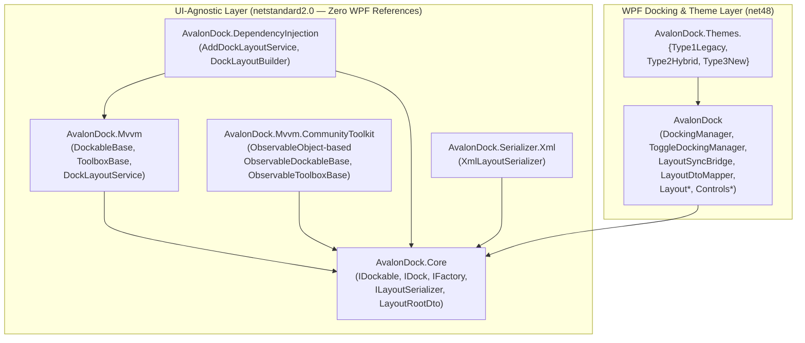

# AvalonDock Repository Map

**Repository Root:** `C:\SOFTDEV\AvalonDock-V5-NEW`  
**Solution File:** `source/AvalonDock.sln`  
**Current Version Prefix:** `5.1.0` (`source/Directory.Build.props`)  
**Authoritative Documentation:** `documentation/` *(41-page Jekyll `just-the-docs` site for the `NTLDR2/AvalonDock` `v5.1.0` fork)*

> [!NOTE]
> **Documentation & Scope Attribution:** `documentation/` is the single source of truth deployed by `.github/workflows/docs.yml` (`source: ./documentation`). Migration and architecture pages explicitly distinguish upstream `Dirkster99/AvalonDock` (`v5.0.0`–`v5.1.0`) changes from `NTLDR2/AvalonDock` (`v5.1.0` fork) changes.

---

## 1. Top-Level Directory Layout

```text
AvalonDock-V5-NEW/
├── .agents/
│   └── skills/
│       ├── avalondock-internals/
│       │   └── SKILL.md               # On-demand deep dive into AvalonDock v5 engine internals
│       └── theme-super-test-bridge/
│           └── SKILL.md               # Antigravity multimodal inspection & XML AgentBridge skill for ThemeSuperTestApp
├── .github/
│   ├── dependabot.yml                 # Automated dependency updates
│   └── workflows/
│       ├── ci.yml                     # PR build (--warnaserror) + Unit + FlaUI (.NET Framework 4.8) tests
│       ├── release.yml                # Pack all 9 NuGet packages, OIDC push to nuget.org, GitHub Release
│       └── docs.yml                   # GitHub Pages Jekyll deployment workflow (builds ./documentation on documentation/**)
├── documentation/                     # AUTHORITATIVE v5.1.0 fork documentation site (40 pages + screenshots)
│   ├── _config.yml                    # Jekyll / just-the-docs@v0.10.0 configuration
│   ├── Gemfile                        # github-pages Ruby gem bundle
│   ├── index.md                       # Home (nav_order: 1)
│   ├── getting-started/               # Installation, Quick Start, Building from Source (nav_order: 2)
│   ├── concepts/                      # Architecture, Layout Model, Docs/Anchorables, Floating Windows (nav_order: 3)
│   ├── guides/                        # MVVM, ToggleDockingManager, DI, Serialization, Theming, Custom Themes, Caliburn.Micro (nav_order: 4)
│   ├── tutorials/                     # MVVM IDE, DI App, Styling & Theming, Layout Persistence (nav_order: 5)
│   ├── themes/                        # Gallery + VS, VS2013, VS2010, Expression, Metro, Aero (nav_order: 6)
│   ├── api-reference/                 # DockingManager, ToggleDockingManager, Layout, Controls, Events, Core/MVVM (nav_order: 7)
│   ├── migration/                     # v4 -> v5 Migration Checklist & Breaking Changes (nav_order: 8)
│   ├── contributing.md                # Contributor workflow & quality gates (nav_order: 9)
│   └── images/                        # AvalonDockCodeApp Dark/Light PNG screenshots
├── source/
│   ├── AvalonDock.sln                 # Master Visual Studio solution (17 projects)
│   ├── Directory.Build.props          # Centralized TFMs, VersionPrefix (5.1.0), analyzers, TreatWarningsAsErrors
│   ├── .editorconfig                  # Code formatting & analyzer rules
│   ├── Components/                    # 9 shipped Dirkster.AvalonDock* NuGet library & theme category projects
│   │   ├── THEMES.md                  # Authoritative 18-theme architecture & 5-target dictionary swap reference
│   │   └── THEMES-ANALYSIS-AND-BEST-PRACTICES.md # 3-tier Theme taxonomy chronology & net48 WPF best practices
│   ├── AutomationTest/
│   │   └── AvalonDockTest/            # NUnit unit/STA tests + FlaUI UI automation suite
│   ├── AvalonDockCodeApp/             # Flagship v5 sample app (ToggleDockingManager + CommunityToolkit.Mvvm + Type3New)
│   ├── MVVMTestApp/                   # Classic MVVM + XmlLayoutSerializer sample app
│   ├── TestApp/                       # Classic XAML code-behind sample app
│   ├── MLibTest/                      # Multi-project MLib theming sample
│   ├── CaliburnDockTestApp/           # Caliburn.Micro 6 + classic DockingManager (DocumentsSource vs TabControl) sync harness
│   ├── ExperimentalTestApp/           # Caliburn.Micro 6 + classic DockingManager (DockLayout) reference sample
│   ├── ThemeSuperTestApp/             # Caliburn.Micro 6 + classic DockingManager 18-theme visual debugger, 6-tool profiler/auditor & Antigravity XML AgentBridge
│   ├── WinFormsTestApp/               # WindowsFormsHost interop sample
│   └── AvalonDocPanelMemoryLeaks/     # Memory-leak regression harness
├── AGENTS.md                          # Build, test, code-style, and commit instructions for AI agents
├── CONTRIBUTING.md                    # Root contributor guidelines
├── LICENSE                            # Open-source license packed into all 9 NuGet packages
├── README.md                          # Repository landing page & fork Quick Start
├── REPO_MAP.md                        # This repository map
├── ROADMAP.md                         # SomaFrameQD vendoring, Caliburn.Micro BCL, sample audit & AvalonDox rebrand
└── SLOC_Report.md                     # Detailed SLOC metrics
```

---

## 2. Architectural Layering & Dependency Flow

AvalonDock v5 separates **UI-agnostic abstractions, MVVM base classes, DI registration, and DTO XML serialization (`netstandard2.0`)** from **WPF visual controls and themes (`net48`, zero `System.Text.Json`)**:



### Key Runtime Bridges Inside `source/Components/AvalonDock/`
- **`LayoutSyncBridge`** (`LayoutSyncBridge.cs`) — Synchronizes `AvalonDock.Core` `IRootDock` / `IDockable` ViewModels two-way with the WPF `LayoutRoot` tree (`DockingManager.DockLayout` property).
- **`LayoutDtoMapper`** (`Serialization/LayoutDtoMapper.cs`) — Implements `ILayoutDtoMapper` on `DockingManager` (`ISerializableLayout`), converting between WPF `LayoutRoot` elements and UI-agnostic `LayoutRootDto` graphs consumed by `XmlLayoutSerializer` and custom `LayoutSerializerBase` subclasses.
- **`ILayoutEngine`** (`ILayoutEngine.cs`) — Strategy interface implemented by `DefaultLayoutEngine` (classic `DockingManager` auto-hide strips) and `ToggleLayoutEngine` (`ToggleDockingManager` VS Code / Rider toggle sidebars and detached windows).
- **`ThemeManager`** (`ThemeManager.cs`) — Implements `AvalonDock.Core.IThemeManager` so ViewModels/services can switch WPF `Theme` instances by name without referencing WPF types.

---

## 3. Shipped NuGet Packages (`source/Components/*` — 9 Packages)

All 9 component projects are packed and published together by `.github/workflows/release.yml`:

| Project Folder (`source/Components/…`) | NuGet Package ID | Target Framework(s) | Primary Namespace(s) | Primary Documentation (`documentation/…`) |
|:---|:---|:---|:---|:---|
| `AvalonDock` | `Dirkster.AvalonDock` | `net48` | `AvalonDock`, `AvalonDock.Layout`, `AvalonDock.Controls`, `AvalonDock.Themes`, `AvalonDock.Themes.Type1Legacy`, `AvalonDock.Commands`, `AvalonDock.Converters` | `api-reference/docking-manager.md`, `api-reference/toggle-docking-manager.md`, `api-reference/layout-classes.md`, `api-reference/controls.md`, `api-reference/events.md` |
| `AvalonDock.Core` | `Dirkster.AvalonDock.Core` | `netstandard2.0` | `AvalonDock.Core`, `AvalonDock.Core.Events`, `AvalonDock.Core.Controls`, `AvalonDock.Core.Serialization`, `AvalonDock.Core.Serialization.Dto` | `concepts/architecture.md`, `api-reference/core-and-mvvm.md` |
| `AvalonDock.Mvvm` | `Dirkster.AvalonDock.Mvvm` | `netstandard2.0` | `AvalonDock.Mvvm` | `guides/mvvm.md`, `api-reference/core-and-mvvm.md` |
| `AvalonDock.Mvvm.CommunityToolkit` | `Dirkster.AvalonDock.Mvvm.CommunityToolkit` | `netstandard2.0` | `AvalonDock.Mvvm.CommunityToolkit` | `guides/mvvm.md`, `tutorials/mvvm-ide.md`, `api-reference/core-and-mvvm.md` |
| `AvalonDock.DependencyInjection` | `Dirkster.AvalonDock.DependencyInjection` | `netstandard2.0` | `AvalonDock.DependencyInjection` | `guides/dependency-injection.md`, `tutorials/dependency-injection-app.md`, `api-reference/core-and-mvvm.md` |
| `AvalonDock.Serializer.Xml` | `Dirkster.AvalonDock.Serializer.Xml` | `netstandard2.0` | `AvalonDock.Serializer.Xml` | `guides/serialization.md`, `tutorials/layout-persistence.md` |
| `AvalonDock.Themes.Type1Legacy` | `Dirkster.AvalonDock.Themes.Type1Legacy` | `net48` | `AvalonDock.Themes.Type1Legacy`, `AvalonDock.Themes.Type1Legacy.Controls` | `themes/vs2010.md`, `themes/expression.md`, `themes/metro.md`, `themes/aero.md` |
| `AvalonDock.Themes.Type2Hybrid` | `Dirkster.AvalonDock.Themes.Type2Hybrid` | `net48` | `AvalonDock.Themes.Type2Hybrid`, `AvalonDock.Themes.Type2Hybrid.Themes` | `themes/vs2013.md`, `guides/theming.md` |
| `AvalonDock.Themes.Type3New` | `Dirkster.AvalonDock.Themes.Type3New` | `net48` | `AvalonDock.Themes.Type3New`, `AvalonDock.Themes.Type3New.Themes` | `themes/vs.md`, `guides/theming.md`, `guides/custom-themes.md` |

---

## 4. Component Source Directory Breakdown

### 4.1 `source/Components/AvalonDock.Core/`
UI-agnostic contracts and DTOs (`GenerateDocumentationFile=true`, `#nullable enable`):
- **`Enums.cs`** — `DockMode`, `DockOperation`, `Alignment`, `DockSide`, `DockZone`.
- **`Interfaces/`** — `IDockable`, `IDock`, `IDocumentDock`, `IRootDock`, `IToolbox`, `IDockState`, `IFactory`, `IDockingManager`, `IDockLayoutService`, `IAutoHideManager`, `IFloatingWindowService`, `IDragDropHandler`, `IThemeManager`, `IThemeInfo`, `ILayoutSerializer`.
- **`FactoryBase.cs` & `FactoryBase.Events.cs`** — Base dock factory implementation and lifecycle event raising.
- **`Events/DockEventArgs.cs`** — Strongly typed event args for `IFactory` / `IDockingManager` events.
- **`Controls/`** — Pure-logic drag-drop target rules (`DropTargetType`, `OverlayPreviewRules`, `OverlayTabTargetRules`).
- **`Serialization/`** — `ISerializableLayout`, `ILayoutDtoMapper`, `LayoutSerializerBase`, `LayoutSerializerExtensions`, `LayoutSerializationCallbackEventArgs`, and 17 DTO classes in `Serialization/Dto/`.

### 4.2 `source/Components/AvalonDock/`
Main WPF docking engine (`https://github.com/NTLDR2/AvalonDock` XAML namespace):
- **Project Root (`*.cs`)** — `DockingManager.cs`, `ToggleDockingManager.cs`, `ILayoutEngine.cs`, `DefaultLayoutEngine.cs`, `ToggleLayoutEngine.cs`, `ToggleLayoutStrategy.cs`, `DockAlignmentStrategy.cs`, `LayoutSyncBridge.cs`, `ThemeManager.cs`, Win32/window helpers, and lifecycle `*EventArgs.cs`.
- **`Layout/`** — Logical docking tree models (`ILayoutElement` hierarchy: `LayoutRoot`, `LayoutPanel`, `LayoutDocumentPaneGroup`, `LayoutDocumentPane`, `LayoutAnchorablePaneGroup`, `LayoutAnchorablePane`, `LayoutDocument`, `LayoutAnchorable`, `LayoutAnchorSide`, `LayoutAnchorGroup`, `LayoutDocumentFloatingWindow`, `LayoutAnchorableFloatingWindow`, `AnchorSide`, `ILayoutUpdateStrategy`).
- **`Controls/`** — Visual WPF controls, chrome, floating & detached windows (`DetachedAnchorableWindow`), toggle sidebar controls (`ToggleDockButton`, `ToggleDockButtonBar`), drag/drop overlays (`OverlayWindow`, `DragService`), and `NavigatorWindow`.
- **`Serialization/LayoutDtoMapper.cs`** — Bidirectional `LayoutRoot` <-> `LayoutRootDto` mapper.
- **`Themes/`** — `Theme` (abstract pack-URI base), `DictionaryTheme` (abstract runtime `ResourceDictionary` base), `GenericTheme`, and default `Themes/generic.xaml`.
- **`Commands/` & `Converters/`** — `RelayCommand` and XAML value converters.
- **`Properties/`** — `AssemblyInfo.cs` (`XmlnsDefinition` mappings) and localized `Resources.*.resx` string tables.

### 4.3 MVVM, DI & Serializer Extensions
- **`AvalonDock.Mvvm/`** — Zero-dependency MVVM base classes (`DockableBase`, `ToolboxBase`, `DockLayoutService`, `SideToggleManager`, `RootDock`, `DocumentDock`, `ToolDock`).
- **`AvalonDock.Mvvm.CommunityToolkit/`** — `CommunityToolkit.Mvvm.ComponentModel.ObservableObject` counterparts (`ObservableDockableBase`, `ObservableToolboxBase`, `ObservableDocument`, `ObservableTool`) compatible with `[ObservableProperty]` and `[RelayCommand]` C# source generators.
- **`AvalonDock.DependencyInjection/`** — `ServiceCollectionExtensions.AddDockLayoutService(Action<DockLayoutBuilder>)` and `AddAvalonDock` extensions.
- **`AvalonDock.Serializer.Xml/`** — `XmlLayoutSerializer` (`System.Xml.Serialization`), inheriting `LayoutSerializerBase` and implementing `ILayoutSerializer`.

### 4.4 Theme Category Packages (`source/Components/AvalonDock.Themes.*` — 3 Packages)
All 3 theme category packages target `net48` exclusively with **zero external NuGet dependencies** and map onto `https://github.com/NTLDR2/AvalonDock` via `[XmlnsDefinition]` (see `source/Components/THEMES.md` and `source/Components/THEMES-ANALYSIS-AND-BEST-PRACTICES.md` for full architecture details):

1. **`AvalonDock.Themes.Type1Legacy` (`Theme` URI Base, `namespace AvalonDock.Themes.Type1Legacy`):**
   - Consolidates `AeroTheme` (`AeroColors`, `AeroSplineBorder`), `ExpressionDarkTheme` & `ExpressionLightTheme` (`ExpressionSplineBorder`), `MetroTheme`, and `VS2010Theme` under `Themes/{Aero,Expression,Metro,VS2010}/` (paired with core `GenericTheme` in `AvalonDock.dll`).
2. **`AvalonDock.Themes.Type2Hybrid` (`DictionaryTheme` Base, `namespace AvalonDock.Themes.Type2Hybrid`):**
   - `Vs2013BlueTheme`, `Vs2013DarkTheme`, `Vs2013LightTheme` (`VsThemePaletteFactory` decompresses embedded `vs2013*.vstheme.gz` streams into frozen `SolidColorBrush` dictionaries keyed by `AvalonDock.Themes.Type2Hybrid.Themes.ResourceKeys` & `MenuKeys`, merged with `Themes/Generic.xaml`).
3. **`AvalonDock.Themes.Type3New` (`VsTheme : DictionaryTheme` Base, `namespace AvalonDock.Themes.Type3New`):**
   - `VS2015{Blue,Dark,Light}Theme`, `VS2022{Blue,Dark,Light}Theme`, `VS2026{Blue,Dark,Light}Theme`, plus `VsTheme` (`{avalonDock:VsTheme}` XAML extension). Parses XML `.vstheme` / `.vstheme.gz` (`VsThemeParser`) and pure-C# VS2026 `.json` color overrides (`VsJsonThemeParser`, zero `System.Text.Json`) into frozen brushes on `AvalonDock.Themes.Type3New.Themes.ResourceKeys` & `MenuKeys`, merging flat (`Themes/Generic.xaml`) or rounded-corner (`Themes/VS2022/Generic.xaml`) templates.

---

## 5. Sample Applications & Automated Test Suite (`source/*`)

| Path | Role & Key Details |
|:---|:---|
| `source/AvalonDockCodeApp/` | **Primary v5 Reference App.** Demonstrates `ToggleDockingManager`, `AvalonDock.Mvvm.CommunityToolkit`, toggle sidebars, detached windows, and `VS2026DarkTheme` / `VS2026LightTheme` (`Type3New`). Also serves as the target executable for the FlaUI ToggleDock UI automation suite. |
| `source/MVVMTestApp/` | Classic MVVM sample demonstrating `DocumentsSource`, `AnchorablesSource`, `LayoutInitializer`, and `XmlLayoutSerializer`. |
| `source/TestApp/` | Classic XAML-first `DockingManager` sample application. |
| `source/ExperimentalTestApp/` | *(NTLDR2 Fork)* Reference sample: Caliburn.Micro 6.0.15-beta (`SimpleContainer`, conductor, actions, `IEventAggregator`) hosting the classic `DockingManager` through `DockLayout` + `IDockLayoutService`. Sample-internal `IDockable`/`IToolbox` boilerplate (`Boilerplate/`) and WPF glue (`Docking/`). Targets `net48`, in `AvalonDock.sln`. See its `README.md`. |
| `source/ThemeSuperTestApp/` | *(NTLDR2 Fork)* Caliburn.Micro 6.0.15-beta + classic `DockingManager` (`DockLayout` + `IDockLayoutService`) **18-theme visual debugger, 6-tool profiler/auditor, dual-mode WPF/Win32 DWM screenshot stitcher, and Antigravity XML `AgentBridge`** (`F12` snapshot push + 16-verb `inbox/` -> `outbox/` command loop, paired with `.agents/skills/theme-super-test-bridge/SKILL.md`). Targets `net48` with zero `System.Text.Json`, in `AvalonDock.sln`. See its `README.md`. |
| `source/CaliburnDockTestApp/` | *(NTLDR2 Fork — Modernized)* Side-by-side Caliburn.Micro 6.0.15-beta (`SimpleContainer`, pure `x:Name` conventions, `DocumentCloseBehavior`, system-default async `ConfirmCloseView`) diagnostic harness comparing `DockingManager.DocumentsSource` against WPF `TabControl.ItemsSource` (`cal:View.Context="TabControl"` isolation). Targets `net48` with zero `System.Text.Json`, in `AvalonDock.sln`. See its `README.md`. |
| `source/MLibTest/`, `source/WinFormsTestApp/`, `source/AvalonDocPanelMemoryLeaks/` | Specialized test harnesses for MLib theming, WinForms `WindowsFormsHost` interop, and memory-leak regression checks. |
| `source/AutomationTest/AvalonDockTest/` | Automated test suite (`net48`):<br>• **Unit & STA Tests (`Category!=FlaUI`):** Layout tree manipulation, XML serialization & `LayoutDtoMapper` round-trips, `LayoutSyncBridge`, MVVM/DI, theme & parser verification (`VsJsonThemeParserTests`, `VsThemeParserTests`, `VsThemeToggleDockingManagerTests`), `CaliburnDockTestApp` synchronization & async close verification (`CaliburnDockTestAppTests`), `ThemeSuperTestApp` diagnostics & XML bridge verification (`ThemeSuperTestAppDiagnosticsTests`, `ThemeSuperTestAppAgentBridgeTests`), and memory/unload tests.<br>• **FlaUI UI Tests (`FlaUI/`, `Category=FlaUI`):** End-to-end Windows UI Automation driving real WPF windows (`TestApp` and `AvalonDockCodeApp`). |

---

## 6. Authoritative v5 Documentation Map (`documentation/` — 41 Pages)

All internal Jekyll links in `documentation/` use `{{ site.baseurl }}` and local screenshots use `{{ site.baseurl }}/images/<file>.png`.

| Top-Level Nav (`nav_order`) | Index / Landing Page | Child Pages (`nav_order`) |
|:---|:---|:---|
| **1. Home** | `documentation/index.md` | — |
| **2. Getting Started** | `documentation/getting-started/index.md` | `1` `getting-started/installation.md` — All 9 NuGet packages & TFMs<br>`2` `getting-started/quick-start.md` — 5-minute WPF docking layout<br>`3` `getting-started/building-from-source.md` — SDKs, `--warnaserror`, unit & FlaUI tests |
| **3. Concepts** | `documentation/concepts/index.md` | `1` `concepts/architecture.md` — v5 `Core` vs WPF split, `LayoutSyncBridge`, engines<br>`2` `concepts/layout-model.md` — `LayoutRoot`, panels, groups, panes, proportions<br>`3` `concepts/documents-and-anchorables.md` — Lifecycle, closing vs hiding, `ContentId`<br>`4` `concepts/floating-windows.md` — Floating vs `DetachedAnchorableWindow`, `OverlayWindow` |
| **4. Guides** | `documentation/guides/index.md` | `1` `guides/mvvm.md` — `RootDock` + `IDockLayoutService` vs `DocumentsSource`/`AnchorablesSource`<br>`2` `guides/toggle-docking-manager.md` — Sidebars, popups, docked splits, detached windows<br>`3` `guides/dependency-injection.md` — `AddDockLayoutService`, `IThemeManager`<br>`4` `guides/serialization.md` — `XmlLayoutSerializer`, `LayoutSerializationCallback`, custom DTO serializers<br>`5` `guides/theming.md` — Applying & switching all 3 theme category packages + `GenericTheme`<br>`6` `guides/custom-themes.md` — `DictionaryTheme`, `VsTheme` & `ResourceKeys`<br>`7` `guides/caliburn-micro.md` — Hosting classic `DockingManager` (`DockLayout` + `IDockLayoutService`) with Caliburn.Micro 6.0.15-beta |
| **5. Tutorials** | `documentation/tutorials/index.md` | `1` `tutorials/mvvm-ide.md` — Full MVVM IDE with `CommunityToolkit.Mvvm` & `ToggleDockingManager`<br>`2` `tutorials/dependency-injection-app.md` — DI multi-pane application<br>`3` `tutorials/styling-and-theming.md` — Live theme switcher, persisted settings, custom corporate & `DictionaryTheme` themes<br>`4` `tutorials/layout-persistence.md` — End-to-end XML workspace save/restore |
| **6. Themes** | `documentation/themes/index.md` | `1` `themes/vs.md` — `VS2015*`, `VS2022*`, `VS2026*` & `VsTheme` (`Type3New`, `.vstheme` / pure-C# VS2026 JSON)<br>`2` `themes/vs2013.md` — `Vs2013BlueTheme` / `Vs2013DarkTheme` / `Vs2013LightTheme` (`Type2Hybrid`)<br>`3` `themes/vs2010.md` — `VS2010Theme` (`Type1Legacy`)<br>`4` `themes/expression.md` — `ExpressionDarkTheme` / `ExpressionLightTheme` (`Type1Legacy`)<br>`5` `themes/metro.md` — `MetroTheme` (`Type1Legacy`)<br>`6` `themes/aero.md` — `AeroTheme` & `AeroColors` (`Type1Legacy`) |
| **7. API Reference** | `documentation/api-reference/index.md` | `1` `api-reference/docking-manager.md`<br>`2` `api-reference/toggle-docking-manager.md`<br>`3` `api-reference/layout-classes.md`<br>`4` `api-reference/controls.md`<br>`5` `api-reference/events.md`<br>`6` `api-reference/core-and-mvvm.md` |
| **8. Migration** | `documentation/migration/index.md` | `1` `migration/breaking-changes.md` — Detailed v4 -> v5 breaking changes & code fixes |
| **9. Contributing** | `documentation/contributing.md` | — |

---

## 7. Build, Test & Quality Gates Quick Reference

```powershell
# 1. Restore & Build (warnings treated as errors)
dotnet restore source/AvalonDock.sln
dotnet build source/AvalonDock.sln --configuration Release --no-restore --warnaserror

# 2. Run Unit Tests (single-threaded -m:1 required for .NET Framework test targets)
dotnet test source/AvalonDock.sln --configuration Release --no-restore --filter "Category!=FlaUI" -m:1

# 3. Run FlaUI UI Automation Tests (.NET Framework 4.8)
dotnet test source/AvalonDock.sln --configuration Release --no-restore --filter "Category=FlaUI" --framework net48 -m:1
```

- **Commit Message Format:** `[Fix|Feature] #<TicketID> - [<Topic>] <What was done>`

---

## 8. "Where Do I Look To…?" Task Lookup

| Task | Source Files (`source/…`) | Documentation (`documentation/…`) |
|:---|:---|:---|
| Add or modify a `DockingManager` dependency property, template, or event | `Components/AvalonDock/DockingManager.cs`, `*EventArgs.cs` | `api-reference/docking-manager.md`, `api-reference/events.md` |
| Work on `ToggleDockingManager`, edge sidebars, or detached windows | `Components/AvalonDock/ToggleDockingManager.cs`, `ToggleLayoutEngine.cs`, `Controls/Toggle*.cs`, `Controls/DetachedAnchorableWindow.cs`, `AvalonDockCodeApp/` | `guides/toggle-docking-manager.md`, `api-reference/toggle-docking-manager.md`, `concepts/floating-windows.md` |
| Modify the logical layout tree or pane proportions | `Components/AvalonDock/Layout/*.cs`, `DefaultLayoutEngine.cs` | `concepts/layout-model.md`, `concepts/documents-and-anchorables.md`, `api-reference/layout-classes.md` |
| Change UI-agnostic MVVM contracts or `RootDock` sync | `Components/AvalonDock.Core/Interfaces/*.cs`, `FactoryBase*.cs`, `Components/AvalonDock.Mvvm*/*.cs`, `Components/AvalonDock/LayoutSyncBridge.cs` | `concepts/architecture.md`, `guides/mvvm.md`, `api-reference/core-and-mvvm.md` |
| Update DI service registration (`AddDockLayoutService`) | `Components/AvalonDock.DependencyInjection/*.cs`, `Components/AvalonDock/ThemeManager.cs` | `guides/dependency-injection.md`, `tutorials/dependency-injection-app.md` |
| Add a serialized layout property (XML & DTOs) | `Components/AvalonDock.Core/Serialization/Dto/*.cs`, `Components/AvalonDock/Serialization/LayoutDtoMapper.cs`, `Components/AvalonDock.Serializer.Xml/` | `guides/serialization.md`, `tutorials/layout-persistence.md` |
| Modify drag-drop docking targets or `Ctrl+Tab` navigator | `Components/AvalonDock/Controls/OverlayWindow.cs`, `*DropTarget.cs`, `DragService.cs`, `NavigatorWindow.cs`, `Components/AvalonDock.Core/Controls/Overlay*.cs` | `concepts/floating-windows.md`, `api-reference/controls.md` |
| Add, debug, profile, or fix a theme or brush key | `Components/AvalonDock/Themes/*.cs`, `Components/AvalonDock.Themes.*`, `Components/THEMES.md`, `Components/THEMES-ANALYSIS-AND-BEST-PRACTICES.md`, `ThemeSuperTestApp/` | `themes/index.md`, `themes/vs.md`, `themes/vs2013.md`, `guides/theming.md`, `guides/custom-themes.md`, `.agents/skills/theme-super-test-bridge/SKILL.md` |
| Add unit tests or FlaUI UI automation tests | `AutomationTest/AvalonDockTest/*.cs` (`VsJsonThemeParserTests.cs`, `VsThemeParserTests.cs`, `VsThemeToggleDockingManagerTests.cs`, `ThemeSuperTestAppDiagnosticsTests.cs`, `ThemeSuperTestAppAgentBridgeTests.cs`), `AutomationTest/AvalonDockTest/FlaUI/*.cs` | `getting-started/building-from-source.md`, `contributing.md` |
| Host AvalonDock in a Caliburn.Micro app, or implement the optional `AvalonDock.Mvvm.CaliburnMicro` | `ExperimentalTestApp/` (`Boilerplate/`, `Docking/`, `README.md`), `ThemeSuperTestApp/`, `Components/AvalonDock.Mvvm.CommunityToolkit/*.cs`, `Components/AvalonDock.Mvvm/*.cs` | `documentation/guides/caliburn-micro.md`, root `ROADMAP.md` + AI-ready Caliburn.Micro internals repo (`https://github.com/NTLDR2/Caliburn.Micro`) |
