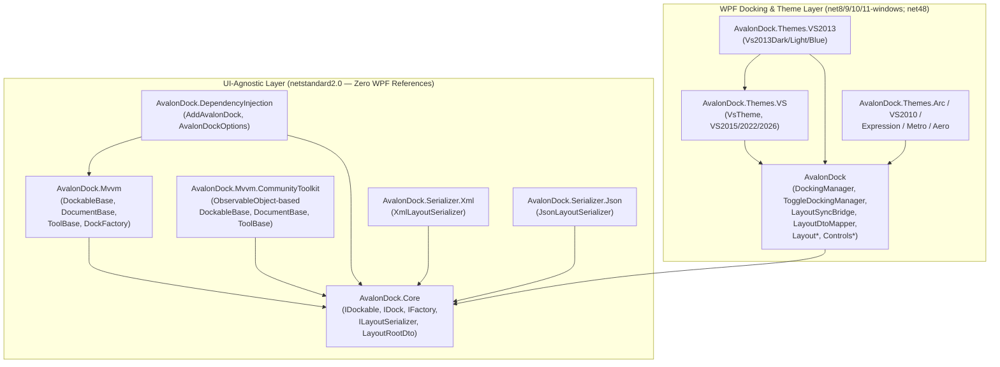

# AvalonDock Repository Map

**Repository Root:** `C:\SOFTDEV\AvalonDock-V5-NEW`  
**Solution File:** `source/AvalonDock.sln`  
**Current Version Prefix:** `5.1.0` (`source/Directory.Build.props`)  
**Authoritative Documentation:** `new-docs-carbon4/` *(40-page Jekyll `just-the-docs` v5 site)*

> [!CAUTION]
> **`docs/` is legacy/obsolete.** Do **not** consult or update `C:\SOFTDEV\AvalonDock-V5-NEW\docs` for current v5 APIs, package names, theme URIs, or architecture. Always use **`C:\SOFTDEV\AvalonDock-V5-NEW\new-docs-carbon4`** as the single source of truth for AvalonDock v5+ documentation.

---

## 1. Top-Level Directory Layout

```text
AvalonDock-V5-NEW/
├── .github/
│   ├── dependabot.yml                 # Automated dependency updates
│   └── workflows/
│       ├── ci.yml                     # PR build (--warnaserror) + Unit + FlaUI (.NET 10 & 11) tests
│       ├── release.yml                # Pack all 14 NuGet packages, OIDC push to nuget.org, GitHub Release
│       └── docs.yml                   # GitHub Pages Jekyll deployment workflow (update source path on cutover)
├── new-docs-carbon4/                  # AUTHORITATIVE v5 documentation site (40 pages + 8 PNGs)
│   ├── _config.yml                    # Jekyll / just-the-docs@v0.10.0 configuration
│   ├── Gemfile                        # github-pages Ruby gem bundle
│   ├── index.md                       # Home (nav_order: 1)
│   ├── getting-started/               # Installation, Quick Start, Building from Source (nav_order: 2)
│   ├── concepts/                      # Architecture, Layout Model, Docs/Anchorables, Floating Windows (nav_order: 3)
│   ├── guides/                        # MVVM, ToggleDockingManager, DI, Serialization, Theming, Custom Themes (nav_order: 4)
│   ├── tutorials/                     # MVVM IDE, DI App, Styling & Theming, Layout Persistence (nav_order: 5)
│   ├── themes/                        # Gallery + Arc, VS, VS2013, VS2010, Expression, Metro, Aero (nav_order: 6)
│   ├── api-reference/                 # DockingManager, ToggleDockingManager, Layout, Controls, Events, Core/MVVM (nav_order: 7)
│   ├── migration/                     # v4 -> v5 Migration Checklist & Breaking Changes (nav_order: 8)
│   ├── contributing.md                # Contributor workflow & quality gates (nav_order: 9)
│   └── images/                        # 8 AvalonDockCodeApp Dark/Light PNG screenshots
├── docs/                              # [LEGACY / OBSOLETE] Pre-regeneration documentation — ignore
├── source/
│   ├── AvalonDock.sln                 # Master Visual Studio solution (26 projects)
│   ├── Directory.Build.props          # Centralized TFMs, VersionPrefix (5.1.0), analyzers, TreatWarningsAsErrors
│   ├── .editorconfig                  # Code formatting & analyzer rules
│   ├── Components/                    # 14 shipped Dirkster.AvalonDock* NuGet library & theme projects
│   ├── AutomationTest/
│   │   └── AvalonDockTest/            # MSTest unit tests + FlaUI UI automation suite
│   ├── AvalonDockCodeApp/             # Flagship v5 sample app (ToggleDockingManager + CommunityToolkit.Mvvm + Arc)
│   ├── MVVMTestApp/                   # Classic MVVM + XmlLayoutSerializer sample app
│   ├── TestApp/                       # Classic XAML code-behind sample app
│   ├── VS2013Test/                    # VS2013 theme & docking test harness
│   ├── MLibTest/                      # Multi-project MLib theming sample
│   ├── CaliburnDockTestApp/           # Caliburn.Micro integration sample
│   ├── WinFormsTestApp/               # WindowsFormsHost interop sample
│   └── AvalonDocPanelMemoryLeaks/     # Memory-leak regression harness
├── AGENTS.md                          # Build, test, code-style, and commit instructions for AI agents
├── CONTRIBUTING.md                    # Root contributor guidelines
├── LICENSE                            # Open-source license packed into all 14 NuGet packages
├── README.md                          # Repository landing page
├── REPO_MAP.md                        # This repository map
└── SLOC_Report.md                     # Detailed SLOC metrics (87,537 total SLOC / 57,623 shipped component SLOC)
```

---

## 2. Architectural Layering & Dependency Flow

AvalonDock v5 separates **UI-agnostic abstractions, MVVM base classes, DI registration, and DTO serialization (`netstandard2.0`)** from **WPF visual controls and themes (`net8.0-windows`–`net11.0-windows` + `net48`)**:



### Key Runtime Bridges Inside `source/Components/AvalonDock/`
- **`LayoutSyncBridge`** (`LayoutSyncBridge.cs`) — Synchronizes `AvalonDock.Core` `IRootDock` / `IDockable` ViewModels two-way with the WPF `LayoutRoot` tree (`DockingManager.RootDock` property).
- **`LayoutDtoMapper`** (`Serialization/LayoutDtoMapper.cs`) — Implements `ILayoutDtoMapper` on `DockingManager` (`ISerializableLayout`), converting between WPF `LayoutRoot` elements and UI-agnostic `LayoutRootDto` graphs consumed by `XmlLayoutSerializer` and `JsonLayoutSerializer`.
- **`ILayoutEngine`** (`ILayoutEngine.cs`) — Strategy interface implemented by `DefaultLayoutEngine` (classic `DockingManager` auto-hide strips) and `ToggleLayoutEngine` (`ToggleDockingManager` VS Code / Rider toggle sidebars and detached windows).
- **`ThemeManager`** (`ThemeManager.cs`) — Implements `AvalonDock.Core.IThemeManager` so ViewModels/services can switch WPF `Theme` instances by name without referencing WPF types.

---

## 3. Shipped NuGet Packages (`source/Components/*` — 14 Packages)

All 14 component projects are packed and published together by `.github/workflows/release.yml`:

| Project Folder (`source/Components/…`) | NuGet Package ID | Target Framework(s) | Primary Namespace(s) | SLOC | Primary Documentation (`new-docs-carbon4/…`) |
|:---|:---|:---|:---|---:|:---|
| `AvalonDock` | `Dirkster.AvalonDock` | `net8/9/10/11-windows;net48` | `AvalonDock`, `AvalonDock.Layout`, `AvalonDock.Controls`, `AvalonDock.Themes`, `AvalonDock.Commands`, `AvalonDock.Converters` | 30,169 | `api-reference/docking-manager.md`, `api-reference/toggle-docking-manager.md`, `api-reference/layout-classes.md`, `api-reference/controls.md`, `api-reference/events.md` |
| `AvalonDock.Core` | `Dirkster.AvalonDock.Core` | `netstandard2.0` | `AvalonDock.Core`, `AvalonDock.Core.Events`, `AvalonDock.Core.Controls`, `AvalonDock.Core.Serialization`, `AvalonDock.Core.Serialization.Dto` | 1,331 | `concepts/architecture.md`, `api-reference/core-and-mvvm.md` |
| `AvalonDock.Mvvm` | `Dirkster.AvalonDock.Mvvm` | `netstandard2.0` | `AvalonDock.Mvvm` | 510 | `guides/mvvm.md`, `api-reference/core-and-mvvm.md` |
| `AvalonDock.Mvvm.CommunityToolkit` | `Dirkster.AvalonDock.Mvvm.CommunityToolkit` | `netstandard2.0` | `AvalonDock.Mvvm.CommunityToolkit` | 231 | `guides/mvvm.md`, `tutorials/mvvm-ide.md`, `api-reference/core-and-mvvm.md` |
| `AvalonDock.DependencyInjection` | `Dirkster.AvalonDock.DependencyInjection` | `netstandard2.0` | `AvalonDock.DependencyInjection` | 208 | `guides/dependency-injection.md`, `tutorials/dependency-injection-app.md`, `api-reference/core-and-mvvm.md` |
| `AvalonDock.Serializer.Xml` | `Dirkster.AvalonDock.Serializer.Xml` | `netstandard2.0` | `AvalonDock.Layout.Serialization` | 56 | `guides/serialization.md`, `tutorials/layout-persistence.md` |
| `AvalonDock.Serializer.Json` | `Dirkster.AvalonDock.Serializer.Json` | `netstandard2.0` | `AvalonDock.Layout.Serialization` | 102 | `guides/serialization.md`, `tutorials/layout-persistence.md` |
| `AvalonDock.Themes.Arc` | `Dirkster.AvalonDock.Themes.Arc` | `net8/9/10/11-windows;net48` | `AvalonDock.Themes`, `AvalonDock.Themes.Arc.Themes` | 4,375 | `themes/arc.md`, `guides/custom-themes.md` |
| `AvalonDock.Themes.VS` | `Dirkster.AvalonDock.Themes.VS` | `net8/9/10/11-windows;net48` | **`AvalonDock.Themes.VS`**, `AvalonDock.Themes.VS.Themes` | 8,868 | `themes/vs.md`, `guides/theming.md`, `guides/custom-themes.md` |
| `AvalonDock.Themes.VS2013` | `Dirkster.AvalonDock.Themes.VS2013` | `net8/9/10/11-windows;net48` | `AvalonDock.Themes`, `AvalonDock.Themes.VS2013.Themes` | 3,790 | `themes/vs2013.md` |
| `AvalonDock.Themes.VS2010` | `Dirkster.AvalonDock.Themes.VS2010` | `net8/9/10/11-windows;net48` | `AvalonDock.Themes` | 2,043 | `themes/vs2010.md` |
| `AvalonDock.Themes.Expression` | `Dirkster.AvalonDock.Themes.Expression` | `net8/9/10/11-windows;net48` | `AvalonDock.Themes` | 2,002 | `themes/expression.md` |
| `AvalonDock.Themes.Metro` | `Dirkster.AvalonDock.Themes.Metro` | `net8/9/10/11-windows;net48` | `AvalonDock.Themes` | 1,903 | `themes/metro.md` |
| `AvalonDock.Themes.Aero` | `Dirkster.AvalonDock.Themes.Aero` | `net8/9/10/11-windows;net48` | `AvalonDock.Themes` | 2,035 | `themes/aero.md` |

---

## 4. Component Source Directory Breakdown

### 4.1 `source/Components/AvalonDock.Core/`
UI-agnostic contracts and DTOs (`GenerateDocumentationFile=true`, `#nullable enable`):
- **`Enums.cs`** — `DockMode`, `DockOperation`, `Alignment`, `DockSide`, `DockZone` (`None`, `Left`, `Right`, `Top`, `Bottom`, `Center`, `Floating`, `AutoHide`).
- **`Interfaces/`** — `IDockable`, `IDock`, `IDocumentDock`, `IRootDock`, `IToolbox`, `IDockState`, `IFactory`, `IDockingManager`, `IDockLayoutService`, `IAutoHideManager`, `IFloatingWindowService`, `IDragDropHandler`, `IThemeManager`, `IThemeInfo`, `ILayoutSerializer`.
- **`FactoryBase.cs` & `FactoryBase.Events.cs`** — Base dock factory implementation and lifecycle event raising (`DockableClosing`, `DockableClosed`, `DockableHiding`, `DockableHidden`, `DockableAdded`, `DockableMoved`, `DockableSwapped`, `DockablePinned`, `DockableUnpinned`, `ActiveDockableChanged`, `FocusedDockableChanged`, `WindowOpened`, `WindowClosing`, `WindowClosed`).
- **`Events/DockEventArgs.cs`** — Strongly typed event args for `IFactory` / `IDockingManager` events.
- **`Controls/`** — Pure-logic drag-drop target rules (`DropTargetType`, `OverlayPreviewRules`, `OverlayTabTargetRules`).
- **`Serialization/`** — `ISerializableLayout`, `ILayoutDtoMapper`, `LayoutSerializerBase`, `LayoutSerializerExtensions`, `LayoutSerializationCallbackEventArgs`, and 14 DTO classes in `Serialization/Dto/` (`LayoutRootDto`, `LayoutPanelDto`, `LayoutDocumentDto`, `LayoutAnchorableDto`, `LayoutFloatingWindowDto`, etc.).

### 4.2 `source/Components/AvalonDock/`
Main WPF docking engine (`https://github.com/Dirkster99/AvalonDock` XAML namespace):
- **Project Root (`*.cs`)** — `DockingManager.cs`, `ToggleDockingManager.cs`, `ILayoutEngine.cs`, `DefaultLayoutEngine.cs`, `ToggleLayoutEngine.cs`, `ToggleLayoutStrategy.cs`, `DockAlignmentStrategy.cs`, `LayoutSyncBridge.cs`, `ThemeManager.cs`, Win32/window helpers, and lifecycle `*EventArgs.cs` (`DocumentClosingEventArgs`, `DocumentClosedEventArgs`, `AnchorableClosingEventArgs`, `AnchorableClosedEventArgs`, `AnchorableHidingEventArgs`, `AnchorableHiddenEventArgs`, `ContentFloatingEventArgs`, `ContentDockedEventArgs`, `LayoutFloatingWindowControlCreatedEventArgs`, `LayoutFloatingWindowControlClosedEventArgs`).
- **`Layout/`** — Logical docking tree models (`ILayoutElement` hierarchy: `LayoutRoot`, `LayoutPanel`, `LayoutDocumentPaneGroup`, `LayoutDocumentPane`, `LayoutAnchorablePaneGroup`, `LayoutAnchorablePane`, `LayoutDocument`, `LayoutAnchorable`, `LayoutAnchorSide`, `LayoutAnchorGroup`, `LayoutDocumentFloatingWindow`, `LayoutAnchorableFloatingWindow`, `AnchorSide`, `DockingManagerLayoutUpdateStrategy` / `ILayoutUpdateStrategy`).
- **`Controls/`** — Visual WPF controls, chrome, and services:
  - Pane & tab controls: `LayoutDocumentPaneControl`, `LayoutAnchorablePaneControl`, `LayoutDocumentControl`, `LayoutAnchorableControl`, `LayoutDocumentTabItem`, `LayoutAnchorableTabItem`, `AnchorablePaneTitle`, `DocumentPaneTabPanel`, `AnchorablePaneTabPanel`, `TabControlEx`.
  - Item view wrappers: `LayoutItem`, `LayoutDocumentItem`, `LayoutAnchorableItem` (expose `ActivateCommand`, `CloseCommand`, `FloatCommand`, `DockAsDocumentCommand`, `AutoHideCommand`, `HideCommand`, etc. for tab/header templates).
  - Floating & detached windows: `LayoutFloatingWindowControl`, `LayoutDocumentFloatingWindowControl`, `LayoutAnchorableFloatingWindowControl`, `WindowHookHandler`, and `DetachedAnchorableWindow` (independent OS window with minimize/maximize taskbar chrome used by `ToggleDockingManager`).
  - Toggle sidebar controls: `ToggleDockButton`, `ToggleSideBarPanel`, `HiddenPanelsDropDown` (internal popup helper), `FloatingPreviewWindow`.
  - Drag/drop & navigation overlays: `OverlayWindow`, `IDropArea`, `DropArea<T>`, `DropAreaType`, `DragService`, `NavigatorWindow` (`Ctrl+Tab`), `LayoutAutoHideWindowControl`, `LayoutGridResizerControl`.
- **`Serialization/LayoutDtoMapper.cs`** — Bidirectional `LayoutRoot` <-> `LayoutRootDto` mapper.
- **`Themes/`** — `Theme` (abstract pack-URI base), `DictionaryTheme` (abstract runtime `ResourceDictionary` base), `GenericTheme`, and default `Themes/generic.xaml`.
- **`Commands/` & `Converters/`** — `RelayCommand` and XAML value converters (`BoolToVisibilityConverter`, `NullToDoNothingConverter`, `AnchorSideToOrientationConverter`, `AnchorSideToAngleConverter`, `ActivateCommandLayoutItemFromLayoutModelConverter`, etc.).
- **`Properties/`** — `AssemblyInfo.cs` (`XmlnsDefinition` mappings) and 20 localized `Resources.*.resx` string tables.

### 4.3 MVVM, DI & Serializer Extensions
- **`AvalonDock.Mvvm/`** — `ObservableObject`, `RelayCommand`, `RelayCommand<T>`, `DockableBase`, `DocumentBase`, `ToolBase`, `ToolboxBase`, `DockState`, `DockFactory`, `DockViewModel`.
- **`AvalonDock.Mvvm.CommunityToolkit/`** — Drop-in `CommunityToolkit.Mvvm.ComponentModel.ObservableObject` counterparts (`DockableBase`, `DocumentBase`, `ToolBase`, `ToolboxBase`, `DockFactory`) compatible with `[ObservableProperty]` and `[RelayCommand]` C# source generators.
- **`AvalonDock.DependencyInjection/`** — `ServiceCollectionExtensions.AddAvalonDock(Action<AvalonDockOptions>)` and `AvalonDockOptions` (`DefaultTheme`, `RegisterDocument<T>()`, `RegisterTool<T>()`, `RegisterTheme(IThemeInfo)`, `UseSerializer<T>()`).
- **`AvalonDock.Serializer.Xml/` & `AvalonDock.Serializer.Json/`** — `XmlLayoutSerializer` (`System.Xml.Serialization`) and `JsonLayoutSerializer` (`System.Text.Json`), both inheriting `LayoutSerializerBase` and implementing `ILayoutSerializer`.

### 4.4 Theme Packages (`source/Components/AvalonDock.Themes.*`)
- **Compiled XAML `Theme` subclasses (`AvalonDock.Themes` namespace):**
  - `AvalonDock.Themes.Arc` — `ArcDarkTheme`, `ArcLightTheme`, `DarkTheme.xaml` / `DarkBrushs.xaml`, `LightTheme.xaml` / `LightBrushs.xaml`, `AvalonDock.Themes.Arc.Themes.ResourceKeys`.
  - `AvalonDock.Themes.VS2010` — `VS2010Theme` (`Theme.xaml`, `Brushes.xaml`).
  - `AvalonDock.Themes.Expression` — `ExpressionDarkTheme`, `ExpressionLightTheme` (`DarkTheme.xaml`, `LightTheme.xaml`).
  - `AvalonDock.Themes.Metro` — `MetroTheme` (`Theme.xaml`, `Brushes.xaml` 7-key palette).
  - `AvalonDock.Themes.Aero` — `AeroTheme` (`Theme.xaml`, `Brushes.xaml`, `AeroColors`).
- **Runtime `DictionaryTheme` subclasses:**
  - `AvalonDock.Themes.VS` (**`AvalonDock.Themes.VS` namespace**) — `VsTheme`, `VsThemeExtension` (`{vs:VsTheme Path=...}`), `VS2015DarkTheme`/`Light`/`Blue`, `VS2022DarkTheme`/`Light`/`Blue`, `VS2026DarkTheme`/`Light`/`Blue`, `VsThemeParser`, `VsJsonThemeParser`, `VsThemeColorPalette`, `VsThemeResourceLoader`, `VsThemeResourceBuilder`, `AvalonDock.Themes.VS.Themes.ResourceKeys`.
  - `AvalonDock.Themes.VS2013` (`AvalonDock.Themes` namespace) — `Vs2013DarkTheme`, `Vs2013LightTheme`, `Vs2013BlueTheme` built at runtime from embedded `Resources/vs2013*.vstheme.gz` via `AvalonDock.Themes.VS` + `AvalonDock.Themes.VS2013.Themes.ResourceKeys`. *(Note: v4 loose `DarkBrushs.xaml` / `DarkTheme.xaml` files no longer exist in v5.)*

---

## 5. Sample Applications & Automated Test Suite (`source/*`)

| Path | Role & Key Details |
|:---|:---|
| `source/AvalonDockCodeApp/` | **Primary v5 Reference App.** Demonstrates `ToggleDockingManager`, `AvalonDock.Mvvm.CommunityToolkit`, toggle sidebars, detached windows, floating document previews, and `ArcDarkTheme` / `ArcLightTheme`. Also serves as the target executable for the FlaUI UI automation suite. |
| `source/MVVMTestApp/` | Classic MVVM sample demonstrating `DocumentsSource`, `AnchorablesSource`, `LayoutInitializer`, and `XmlLayoutSerializer`. |
| `source/TestApp/` | Classic XAML-first `DockingManager` sample application. |
| `source/VS2013Test/`, `source/MLibTest/`, `source/CaliburnDockTestApp/`, `source/WinFormsTestApp/`, `source/AvalonDocPanelMemoryLeaks/` | Legacy/specialized test harnesses for theme switching, Caliburn.Micro, WinForms `WindowsFormsHost` interop, and memory-leak regression checks. |
| `source/AutomationTest/AvalonDockTest/` | Multi-targeted test suite (`net10.0-windows;net11.0-windows;net48`):<br>• **Unit Tests (`Category!=FlaUI`):** Layout tree manipulation, XML/JSON serialization round-trips, `LayoutSyncBridge`, `DockFactory`, `Theme` / `.vstheme` / JSON parsing, memory/unload tests.<br>• **FlaUI UI Tests (`FlaUI/`, `Category=FlaUI`):** End-to-end Windows UI Automation driving real WPF windows (`AvalonDockCodeApp`, drag-and-drop, toggle sidebars, detached windows). |

---

## 6. Authoritative v5 Documentation Map (`new-docs-carbon4/` — 40 Pages)

All internal Jekyll links in `new-docs-carbon4/` use `{{ site.baseurl }}` and local screenshots use `{{ site.baseurl }}/images/<file>.png`.

| Top-Level Nav (`nav_order`) | Index / Landing Page | Child Pages (`nav_order`) |
|:---|:---|:---|
| **1. Home** | `new-docs-carbon4/index.md` | — |
| **2. Getting Started** | `new-docs-carbon4/getting-started/index.md` | `1` `getting-started/installation.md` — All 14 NuGet packages & TFMs<br>`2` `getting-started/quick-start.md` — 5-minute WPF docking layout<br>`3` `getting-started/building-from-source.md` — SDKs, `--warnaserror`, unit & FlaUI tests |
| **3. Concepts** | `new-docs-carbon4/concepts/index.md` | `1` `concepts/architecture.md` — v5 `Core` vs WPF split, `LayoutSyncBridge`, engines<br>`2` `concepts/layout-model.md` — `LayoutRoot`, panels, groups, panes, proportions<br>`3` `concepts/documents-and-anchorables.md` — Lifecycle, closing vs hiding, `ContentId`<br>`4` `concepts/floating-windows.md` — Floating vs `DetachedAnchorableWindow`, `OverlayWindow` |
| **4. Guides** | `new-docs-carbon4/guides/index.md` | `1` `guides/mvvm.md` — `RootDock` + `DockFactory` vs `DocumentsSource`/`AnchorablesSource`<br>`2` `guides/toggle-docking-manager.md` — Sidebars, popups, docked splits, detached windows<br>`3` `guides/dependency-injection.md` — `AddAvalonDock`, `AvalonDockOptions`, `IThemeManager`<br>`4` `guides/serialization.md` — `XmlLayoutSerializer`, `JsonLayoutSerializer`, `LayoutSerializationCallback`<br>`5` `guides/theming.md` — Applying & switching all 7 theme packages + `GenericTheme`<br>`6` `guides/custom-themes.md` — JSON palettes (`VsTheme`), `DictionaryTheme`, `ResourceKeys` |
| **5. Tutorials** | `new-docs-carbon4/tutorials/index.md` | `1` `tutorials/mvvm-ide.md` — Full MVVM IDE with `CommunityToolkit.Mvvm` & `ToggleDockingManager`<br>`2` `tutorials/dependency-injection-app.md` — HostBuilder + DI multi-pane application<br>`3` `tutorials/styling-and-theming.md` — Live theme switcher, persisted settings, custom corporate & JSON themes<br>`4` `tutorials/layout-persistence.md` — End-to-end XML & JSON workspace save/restore |
| **6. Themes** | `new-docs-carbon4/themes/index.md` | `1` `themes/arc.md` — `ArcDarkTheme` / `ArcLightTheme` + screenshots & `ResourceKeys`<br>`2` `themes/vs.md` — `VS2015*`, `VS2022*`, `VS2026*`, `VsTheme` (`.vstheme`, `.vstheme.gz`, JSON)<br>`3` `themes/vs2013.md` — `Vs2013DarkTheme` / `Light` / `Blue` (`.vstheme.gz` `DictionaryTheme`)<br>`4` `themes/vs2010.md` — `VS2010Theme`<br>`5` `themes/expression.md` — `ExpressionDarkTheme` / `ExpressionLightTheme`<br>`6` `themes/metro.md` — `MetroTheme`<br>`7` `themes/aero.md` — `AeroTheme` & `AeroColors` |
| **7. API Reference** | `new-docs-carbon4/api-reference/index.md` | `1` `api-reference/docking-manager.md` — `DockingManager` DPs, templates, methods, events<br>`2` `api-reference/toggle-docking-manager.md` — `ToggleDockingManager` attached properties, methods, events<br>`3` `api-reference/layout-classes.md` — Complete `AvalonDock.Layout` element & interface reference<br>`4` `api-reference/controls.md` — Visual controls, `LayoutItem` commands, `OverlayWindow`, converters<br>`5` `api-reference/events.md` — WPF `DockingManager` events & `AvalonDock.Core` `IFactory` events<br>`6` `api-reference/core-and-mvvm.md` — `AvalonDock.Core`, `Mvvm`, `CommunityToolkit`, `DependencyInjection` |
| **8. Migration** | `new-docs-carbon4/migration/index.md` | `1` `migration/breaking-changes.md` — Detailed v4 -> v5 breaking changes & code fixes |
| **9. Contributing** | `new-docs-carbon4/contributing.md` | — |

> [!IMPORTANT]
> **GitHub Pages Deployment Cutover Note:** `.github/workflows/docs.yml` currently builds Jekyll from `source: ./docs` and triggers on `paths: ["docs/**"]`. When replacing the legacy `docs/` folder with `new-docs-carbon4/`, either replace `docs/` with the contents of `new-docs-carbon4/` or update `.github/workflows/docs.yml` to point to `./new-docs-carbon4`.

---

## 7. Build, Test & Quality Gates Quick Reference

- **OS Requirement:** Windows (`UseWPF=true`) with `.NET 8`, `9`, `10`, and `11` SDKs installed.
- **Zero-Warning Enforcement:** `TreatWarningsAsErrors=true` is enabled globally in `source/Directory.Build.props` along with `Microsoft.CodeAnalysis.NetAnalyzers`, `SonarAnalyzer.CSharp`, and `StyleCop.Analyzers` (on non-test projects). `GenerateDocumentationFile=true` is enabled on `AvalonDock.Core`, `Mvvm*`, `DependencyInjection`, `Serializer.*`, and `Themes.VS2013` — all public members in those projects require XML doc comments.

```powershell
# 1. Restore & Build (warnings treated as errors)
dotnet restore source/AvalonDock.sln
dotnet build source/AvalonDock.sln --configuration Release --no-restore --warnaserror

# 2. Run Unit Tests (single-threaded -m:1 required for .NET Framework test targets)
dotnet test source/AvalonDock.sln --configuration Release --no-restore --filter "Category!=FlaUI" -m:1

# 3. Run FlaUI UI Automation Tests (.NET 10 & .NET 11)
dotnet test source/AvalonDock.sln --configuration Release --no-restore --filter "Category=FlaUI" --framework net10.0-windows -m:1
dotnet test source/AvalonDock.sln --configuration Release --no-restore --filter "Category=FlaUI" --framework net11.0-windows -m:1
```

- **Commit Message Format:** `[Fix|Feature] #<TicketID> - [<Topic>] <What was done>`

---

## 8. "Where Do I Look To…?" Task Lookup

| Task | Source Files (`source/…`) | Documentation (`new-docs-carbon4/…`) |
|:---|:---|:---|
| Add or modify a `DockingManager` dependency property, template, or event | `Components/AvalonDock/DockingManager.cs`, `*EventArgs.cs` | `api-reference/docking-manager.md`, `api-reference/events.md` |
| Work on `ToggleDockingManager`, edge sidebars, or detached windows | `Components/AvalonDock/ToggleDockingManager.cs`, `ToggleLayoutEngine.cs`, `Controls/Toggle*.cs`, `Controls/DetachedAnchorableWindow.cs`, `AvalonDockCodeApp/` | `guides/toggle-docking-manager.md`, `api-reference/toggle-docking-manager.md`, `concepts/floating-windows.md` |
| Modify the logical layout tree or pane proportions | `Components/AvalonDock/Layout/*.cs`, `DefaultLayoutEngine.cs` | `concepts/layout-model.md`, `concepts/documents-and-anchorables.md`, `api-reference/layout-classes.md` |
| Change UI-agnostic MVVM contracts, `DockFactory`, or `RootDock` sync | `Components/AvalonDock.Core/Interfaces/*.cs`, `FactoryBase*.cs`, `Components/AvalonDock.Mvvm*/*.cs`, `Components/AvalonDock/LayoutSyncBridge.cs` | `concepts/architecture.md`, `guides/mvvm.md`, `api-reference/core-and-mvvm.md` |
| Update DI service registration (`AddAvalonDock`) | `Components/AvalonDock.DependencyInjection/*.cs`, `Components/AvalonDock/ThemeManager.cs` | `guides/dependency-injection.md`, `tutorials/dependency-injection-app.md` |
| Add a serialized layout property (XML & JSON) | `Components/AvalonDock.Core/Serialization/Dto/*.cs`, `Components/AvalonDock/Serialization/LayoutDtoMapper.cs`, `Components/AvalonDock.Serializer.Xml/`, `Components/AvalonDock.Serializer.Json/` | `guides/serialization.md`, `tutorials/layout-persistence.md` |
| Modify drag-drop docking targets or `Ctrl+Tab` navigator | `Components/AvalonDock/Controls/OverlayWindow.cs`, `*DropTarget.cs`, `DragService.cs`, `NavigatorWindow.cs`, `Components/AvalonDock.Core/Controls/Overlay*.cs` | `concepts/floating-windows.md`, `api-reference/controls.md` |
| Add or fix a theme, `.vstheme` / VS2026 JSON parser, or brush key | `Components/AvalonDock/Themes/*.cs`, `Components/AvalonDock.Themes.VS/*.cs`, `Components/AvalonDock.Themes.Arc/`, `Components/AvalonDock.Themes.*` | `themes/index.md`, `themes/vs.md`, `themes/arc.md`, `guides/theming.md`, `guides/custom-themes.md` |
| Add unit tests or FlaUI UI automation tests | `AutomationTest/AvalonDockTest/*.cs`, `AutomationTest/AvalonDockTest/FlaUI/*.cs` | `getting-started/building-from-source.md`, `contributing.md` |
