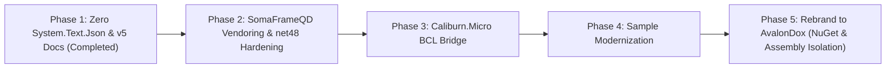

# Roadmap — NTLDR2/AvalonDock Fork

This document tracks the engineering roadmap for **[NTLDR2/AvalonDock](https://github.com/NTLDR2/AvalonDock)** (forked from [Dirkster99/AvalonDock](https://github.com/Dirkster99/AvalonDock)), covering completed foundation work, downstream vendoring into **[NTLDR2/SomaFrameQD](https://github.com/NTLDR2/SomaFrameQD)**, the architectural blueprint for a **Caliburn.Micro** Base Class Library (`AvalonDock.Mvvm.CaliburnMicro`), sample application modernization, and planned fork rebranding from **`AvalonDock` to `AvalonDox`** to eliminate NuGet and CLR assembly naming collisions.

---

## Milestone Overview



| Phase | Focus Area | Status |
|:------|:-----------|:-------|
| **Phase 1** | Surgical removal of `System.Text.Json` packages (`Serializer.Json`, `Themes.VS`, `Themes.VS2013`), 38-page `documentation/` site, `AGENTS.md`, and `avalondock-internals` AI skill | **Completed** |
| **Phase 2** | `.NET Framework 4.8` transitive-dependency audit, build/props isolation, and vendored integration into [NTLDR2/SomaFrameQD](https://github.com/NTLDR2/SomaFrameQD) | **Planned (Next)** |
| **Phase 3** | Design & implementation of `AvalonDock.Mvvm.CaliburnMicro` (`netstandard2.0` BCL equivalent to `AvalonDock.Mvvm.CommunityToolkit`) + STA unit tests | **Proposed / Design Ready** |
| **Phase 4** | Modernize dated sample applications—starting with `source/ExperimentalTestApp` and extending across `source/*Test*` / `AvalonDockCodeApp` | **In Progress** (`ExperimentalTestApp` rewritten for Caliburn.Micro 6.0.15-beta — done) |
| **Phase 5** | Full fork rebranding (**`AvalonDock` → `AvalonDox`**) across NuGet `<PackageId>`s, assembly names, WPF `pack://` URIs, namespaces, and CI release workflows | **Planned** |

---

## Non-Negotiable Architectural Guardrails

Every roadmap item in this fork is governed by four permanent constraints:

1. **Zero `System.Text.Json` (Permanent Ban):** No library, bridge package, sample, or test project may directly or transitively reference `System.Text.Json`. Any candidate third-party NuGet dependency must have its `net48` and `netstandard2.0` dependency graph audited before adoption to prevent `System.Memory` / `System.Buffers` / `System.Runtime.CompilerServices.Unsafe` / `Microsoft.Bcl.AsyncInterfaces` DLL hell.
2. **Strict `.NET Framework 4.8` & WPF Desktop Target:** Every WPF feature, theme dictionary, multi-window mode (`LayoutFloatingWindowControl` and `DetachedAnchorableWindow`), sample application, and STA/FlaUI regression test targets `net48` exclusively (Windows 7 SP1 64-bit through Windows 11) and must compile cleanly (`--warnaserror`), paired with `netstandard2.0` UI-agnostic libraries.
3. **Strict `netstandard2.0` UI-Agnostic Boundary:** ViewModel and service libraries (`AvalonDock.Core`, `AvalonDock.Mvvm`, `AvalonDock.Mvvm.CommunityToolkit`, `AvalonDock.Serializer.Xml`, and the planned `AvalonDock.Mvvm.CaliburnMicro`) must remain pure `netstandard2.0` with zero `System.Windows.*` references.
4. **Inside-Out AI-Readable Documentation:** Architectural changes must simultaneously update `documentation/`, [AGENTS.md](AGENTS.md), and [.agents/skills/avalondock-internals/SKILL.md](.agents/skills/avalondock-internals/SKILL.md) so AI coding agents always operate from ground-truth invariants.

---

## Phase 2: Vendoring into `NTLDR2/SomaFrameQD` & `net48` Hardening

The primary operational goal of this fork is to serve as a clean, deterministic vendored dependency inside **[NTLDR2/SomaFrameQD](https://github.com/NTLDR2/SomaFrameQD)**.

### Planned Tasks
- **Vendoring Topology & MSBuild Isolation:**
  - Ensure `source/Directory.Build.props` does not collide with parent-directory `Directory.Build.props` / `Directory.Packages.props` when mounted as a submodule, Git subtree, or `vendor/` source tree inside `SomaFrameQD`.
  - Provide a lightweight MSBuild import or solution filter containing only the shipped `source/Components/*` projects required by `SomaFrameQD` (excluding sample apps and FlaUI harnesses from host builds).
- **`net48` Zero-Transitive-Bloat Audit:**
  - `AvalonDock`, `AvalonDock.Core`, `AvalonDock.Mvvm`, `AvalonDock.Serializer.Xml`, and all 5 `AvalonDock.Themes.*` libraries already compile on `net48` with **zero** external NuGet runtime dependencies (only inbox `.NET Framework 4.8` BCL + WPF assemblies).
  - Document and verify binding-redirect expectations for optional packages (`AvalonDock.DependencyInjection` and `AvalonDock.Mvvm.CommunityToolkit`, which pull `Microsoft.Bcl.AsyncInterfaces` / `System.Memory` on `net48`) so `SomaFrameQD` can stay 100% inbox-only on `net48` whenever desired.
- **Deterministic Layout Persistence Verification:**
  - Lock down XML DTO round-trip tests (`XmlLayoutDtoMapperRoundTripTests`) for `SomaFrameQD`'s workspace layouts, floating windows, detached OS tool windows, and unresolved-pane handling (`UnresolvedContentHandling`).

---

## Phase 3: Caliburn.Micro Bridge / BCL (`AvalonDock.Mvvm.CaliburnMicro`)

### Motivation

Upstream AvalonDock v5 ships two `netstandard2.0` MVVM ViewModel layers:
1. **`AvalonDock.Mvvm`** — zero external dependencies (`DockableBase`, `ToolboxBase`, `DockBase`, `Document`, `Tool`).
2. **`AvalonDock.Mvvm.CommunityToolkit`** — `CommunityToolkit.Mvvm` `ObservableObject`-backed equivalents (`ObservableDockableBase`, `ObservableToolboxBase`, `ObservableDockBase`, `ObservableDocument`, `ObservableTool`) for developers using `[ObservableProperty]` and `[RelayCommand]` source generators.

Developers building WPF applications with **[Caliburn.Micro](https://github.com/NTLDR2/Caliburn.Micro)** currently have no equivalent v5 bridge, so they write the glue themselves. The rewritten `source/ExperimentalTestApp` (Phase 4) shows exactly that glue as clearly labelled, sample-internal **boilerplate** (`Boilerplate/DockableScreen`, `ToolboxScreen`, `DocumentScreen`, `DockLayoutConductor<T>` plus WPF behaviors in `Docking/`) on top of the classic `DockingManager` + `DockLayout` + `IDockLayoutService`. That folder is the natural starting point for this **optional** BCL.

Creating **`AvalonDock.Mvvm.CaliburnMicro`** will give Caliburn.Micro developers a first-class Base Class Library (BCL) that feels completely native to both Caliburn.Micro (`Screen`, `PropertyChangedBase`, `Conductor<T>`, `NotifyOfPropertyChange`) and AvalonDock v5 (`IDockable`, `IToolbox`, `IDock`, `IDockLayoutService`).

> [!TIP]
> **AI-Ready Companion Internals Repository ([NTLDR2/Caliburn.Micro](https://github.com/NTLDR2/Caliburn.Micro)):** When implementing `AvalonDock.Mvvm.CaliburnMicro` and modernizing `ExperimentalTestApp`, consult **[https://github.com/NTLDR2/Caliburn.Micro](https://github.com/NTLDR2/Caliburn.Micro)** alongside this repository's [AGENTS.md](AGENTS.md) and [SKILL.md](.agents/skills/avalondock-internals/SKILL.md). That companion fork provides AI-ready, inside-out documentation of Caliburn.Micro's internal architecture (`PropertyChangedBase`, `Screen` activation/deactivation state machines, `Conductor<T>` collections, `IGuardClose` async close pipelines, `ViewLocator` / `ViewModelBinder` conventions, and `SimpleContainer`).

### Proposed Project & Package Identity

| Attribute | Specification |
|:----------|:--------------|
| **Project Path** | `source/Components/AvalonDock.Mvvm.CaliburnMicro/AvalonDock.Mvvm.CaliburnMicro.csproj` |
| **Root Namespace & Assembly** | `AvalonDock.Mvvm.CaliburnMicro` |
| **Package ID** | `Dirkster.AvalonDock.Mvvm.CaliburnMicro` *(or fork-scoped equivalent)* |
| **Target Framework** | `netstandard2.0` *(strictly UI-agnostic — zero `System.Windows.*` references)* |
| **Dependencies** | `AvalonDock.Core` (`ProjectReference`) + `Caliburn.Micro.Core` (`netstandard2.0`, zero dependencies; `ExperimentalTestApp` currently uses `6.0.15-beta`) |
| **AI Internals Reference** | **[NTLDR2/Caliburn.Micro](https://github.com/NTLDR2/Caliburn.Micro)** *(AI-friendly Caliburn.Micro internals repository)* |
| **`System.Text.Json` Check** | `Caliburn.Micro.Core` (`netstandard2.0`) has **zero** `System.Text.Json` dependencies (must still pass automated lockfile audit on `net48`) |

### 1-to-1 Base Class Parity with `AvalonDock.Mvvm.CommunityToolkit`

`AvalonDock.Mvvm.CaliburnMicro` mirrors the exact class hierarchy of `AvalonDock.Mvvm.CommunityToolkit` (`source/Components/AvalonDock.Mvvm.CommunityToolkit/`):

| Role | `AvalonDock.Mvvm` *(Zero Deps)* | `AvalonDock.Mvvm.CommunityToolkit` | Proposed `AvalonDock.Mvvm.CaliburnMicro` | Core Interface |
|:-----|:--------------------------------|:-----------------------------------|:-----------------------------------------|:---------------|
| **Abstract dockable base** | `DockableBase` | `ObservableDockableBase` (`: ObservableObject`) | **`CaliburnDockableBase`** (`: Screen, IDockable`) | `IDockable` |
| **Abstract toolbox base** | `ToolboxBase` | `ObservableToolboxBase` | **`CaliburnToolboxBase`** (`: CaliburnDockableBase, IToolbox`) | `IToolbox` |
| **Abstract dock container** | `DockBase` | `ObservableDockBase` | **`CaliburnDockBase`** (`: Conductor<IDockable>.Collection.OneActive, IDock`) | `IDock` |
| **Concrete leaf document** | `Document` | `ObservableDocument` | **`CaliburnDocument`** (`: CaliburnDockableBase`) | `IDockable` |
| **Concrete leaf tool** | `Tool` | `ObservableTool` | **`CaliburnTool`** (`: CaliburnDockableBase`) | `IDockable` |

### Target Developer Experience (Sketch)

With `AvalonDock.Mvvm.CaliburnMicro`, a Caliburn.Micro screen participates directly in `ToggleDockingManager` 6-zone sidebars and `IDockLayoutService` while retaining Caliburn's `Set(...)`, `NotifyOfPropertyChange`, `DisplayName`, and `OnActivatedAsync` / `CanCloseAsync` lifecycle (`OnActivateAsync` / `OnInitializeAsync` are `[Obsolete]` since Caliburn.Micro 5):

```csharp
using AvalonDock.Core;
using AvalonDock.Mvvm.CaliburnMicro;

public class ExplorerViewModel : CaliburnToolboxBase
{
    private string _filterText = string.Empty;

    public ExplorerViewModel()
    {
        Id = "Explorer";
        DisplayName = "Solution Explorer"; // Automatically aliases IDockable.Title
        Zone = DockZone.LeftTop;
        Shortcut = "Ctrl+Shift+E";
        IsOpenByDefault = true;
    }

    public string FilterText
    {
        get => _filterText;
        set => Set(ref _filterText, value);
    }
}
```

### Key Technical Challenges & Design Reconciliations

Implementing `CaliburnDockableBase : Screen, IDockable` cleanly requires solving five subtle contract differences between `Caliburn.Micro.Core` and `AvalonDock.Core`:

#### 1. Bidirectional `IDockable.Title` ↔ `Screen.DisplayName` Synchronization
- **Mismatch:** Caliburn.Micro conventions, conductors, and window managers bind to `IHaveDisplayName.DisplayName`, whereas `LayoutSyncBridge` and AvalonDock styles bind to `IDockable.Title`.
- **Solution:** Override `DisplayName` on `CaliburnDockableBase` and back `Title` with `DisplayName` (or synchronize both setters) so mutating either property raises `NotifyOfPropertyChange(nameof(DisplayName))` **and** `NotifyOfPropertyChange(nameof(Title))` without re-entrancy loops.

#### 2. `IDockable.IsActive { get; set; }` vs. `Screen.IsActive { get; }` Signature Conflict
- **Mismatch:** `Caliburn.Micro.Screen` implements `IActivate.IsActive` as `public bool IsActive { get; private set; }` (mutated only via `ActivateAsync` / `DeactivateAsync`), whereas `AvalonDock.Core.IDockable` declares `bool IsActive { get; set; }`.
- **Correction (verified in source):** `LayoutSyncBridge` does **not** push focus onto `IDockable.IsActive`, and never calls `IDockable.OnClose()` / `OnSelected()`; it only writes `IRootDock.ActiveDockable` and removes closed documents from the `IDocumentDock`. A bridge must derive the focus flag from `IRootDock.ActiveDockable` itself (as `ExperimentalTestApp`'s `DockLayoutConductor<T>` does).
- **Solution:** Keep `Screen.IsActive` intact for Caliburn consumers and implement `bool IDockable.IsActive` explicitly (or route setter transitions through a non-blocking lifecycle adapter that updates active state and invokes `OnSelected()` without corrupting `Screen`'s internal activation flags).

#### 3. Synchronous `IDockable.OnClose()` vs. Asynchronous `IGuardClose.CanCloseAsync`
- **Mismatch:** AvalonDock's `LayoutItem` close command and `DockingManager.DocumentClosing` event evaluate cancellation synchronously on the WPF STA thread (`bool OnClose()`), whereas Caliburn.Micro 4.x uses `Task<bool> CanCloseAsync(CancellationToken)` and `TryCloseAsync`.
- **Solution:**
  - Provide a synchronous virtual guard hook (`protected virtual bool CanCloseSynchronously() => true`) wired to `IDockable.OnClose()` and bridged by default into `CanCloseAsync` (`Task.FromResult(CanCloseSynchronously())`) so standard dirty-document prompts (`IsModified == true`) work identically whether initiated by clicking the AvalonDock tab `X` button or calling Caliburn's `TryCloseAsync()`—**without** calling `.Result` / `.GetAwaiter().GetResult()` on genuinely async UI tasks (which would deadlock the WPF `Dispatcher`).
  - Document the async-close intercept pattern (`DocumentClosing` cancel + `await screen.TryCloseAsync()` + `IDockLayoutService.CloseDocument(doc)`) for apps requiring asynchronous save dialogs.

#### 4. WPF `ViewLocator` (`cal:View.Model`) & Single-Presenter Invariants
- **Context:** In AvalonDock v5, `LayoutItem` (`DataContext = this`, `Model = LayoutElement.Content`) creates a single `ContentPresenter` (`LayoutItem.View`) bound to the ViewModel and `DockingManager.LayoutItemTemplate` (see [SKILL.md](.agents/skills/avalondock-internals/SKILL.md)). Meanwhile, `TabControlEx` caches materialized presenters inside `PART_ItemsHolder` across tab switches, and `DetachedAnchorableWindow` transfers that single `LayoutItem.View` presenter when detaching/re-docking.
- **Solution:** Provide a documented (or optional WPF helper ResourceDictionary) recipe using an **implicit** `<DataTemplate DataType="{x:Type CaliburnDockableBase}"><ContentControl cal:View.Model="{Binding}" IsTabStop="False" /></DataTemplate>` plus `<Setter Property="ContentId" Value="{Binding Model.Id}" />` — **not** `LayoutItemTemplate`. The theme templates host `LayoutItem.View` in an outer `ContentPresenter` that also receives `View.ContentTemplate`, so a `LayoutItemTemplate` sees `DataContext` = the inner presenter in docked/floating panes but the ViewModel in `DetachedAnchorableWindow`. `ExperimentalTestApp` verifies the implicit-template recipe keeps one view instance per ViewModel across tab switching, tear-off `LayoutFloatingWindowControl`, and standalone `DetachedAnchorableWindow` transitions.

#### 5. IoC Container Agnosticism (`SimpleContainer` & `IServiceCollection`)
- **Solution:** Ensure `CaliburnToolboxBase`, `CaliburnDocument`, and `DockLayoutService` work identically whether composed through Caliburn.Micro's classic `BootstrapperBase` + `SimpleContainer` (`GetAllInstances(typeof(IToolbox))`) or via `AvalonDock.DependencyInjection` (`services.AddDockLayoutService(...)`).

---

## Phase 4: Sample Applications Audit & Modernization (`ExperimentalTestApp` & Sibling Samples)

> [!IMPORTANT]
> **Audit Note:** Several sample applications under `source/` predate the full AvalonDock v5 architecture and carry dated target frameworks, pre-release packages, or legacy v4 binding boilerplate. Updating them—starting with **`source/ExperimentalTestApp`**—is an explicit roadmap priority.

### 1. Add `source/ExperimentalTestApp` Alongside Upstream `source/CaliburnDockTestApp` *(Completed — NTLDR2 Fork v5.1.0)*
While preserving the original upstream `source/CaliburnDockTestApp` (Caliburn.Micro `4.0.136-rc`, `#if CALIBURN_ASYNC` shims for Caliburn.Micro 3.2, a local `RelayCommand`, `DisplayRootViewFor<T>()`, off-UI-thread `ActivateItemAsync`, v4-style `DocumentsSource="{Binding Items}"` with an unfiltered `ActiveContent` ↔ `ActiveItem` binding, retargeted to `net48`, standalone outside `AvalonDock.sln`), a modern reference sample **`source/ExperimentalTestApp`** was added to the solution:
- **Stack:** classic `DockingManager` driven by `DockLayout` + `IDockLayoutService` (`AvalonDock.Mvvm`), Caliburn.Micro **6.0.15-beta** (NuGet build of upstream commit `83e93b34`, part of the [NTLDR2/Caliburn.Micro](https://github.com/NTLDR2/Caliburn.Micro) history — zero `System.Text.Json`), `SimpleContainer`, `net48`, VS2010 default theme with runtime switching across all theme packages.
- **Patterns:** sample-internal `IDockable`/`IToolbox` boilerplate on Caliburn.Micro `Screen`s, a conductor synchronized with the layout service, every AvalonDock document close routed through `CanCloseAsync` (serialized Save/Discard/Cancel prompts), 6-zone tool placement on the classic manager, `IToolbox.IsOpen`/`Shortcut` honoured, `IEventAggregator` decoupling, Caliburn.Micro actions instead of `ICommand`, `XmlLayoutSerializer` save/load/reset with auto-save on exit.
- **Docs:** `source/ExperimentalTestApp/README.md` and `documentation/guides/caliburn-micro.md`.
- **Deferred:** a FlaUI smoke test for the sample, and unit tests for the boilerplate (it graduates into tests with the optional Phase 3 BCL).

### 2. Audit & Refresh Remaining Sample Projects in `source/`

| Sample Project | Current State Found in Audit | Planned Cleanup |
|:---------------|:-----------------------------|:----------------|
| **`AvalonDockCodeApp`** | Flagship v5 `ToggleDockingManager` IDE demo, retargeted to `net48` *(completed)* | Keep `net48` FlaUI `ToggleDock` automation suite green |
| **`MVVMTestApp`** | Classic `DocumentsSource` / `AnchorablesSource` + `XmlLayoutSerializer` sample targeting `net48` | Include `ArcDarkTheme` / `ArcLightTheme` in its theme switcher |
| **`WinFormsTestApp`** | `ElementHost` / `WindowsFormsHost` airspace interop test targeting `net48` | Verify `net48` interop focus behavior |
| **`MLibTest`** | Targets `net48`, retains dead MSBuild conditions (`net5.0-windows`, `netcoreapp3.0`, `net40`), and references non-SDK `Settings.csproj` (`v4.8`) | Prune dead pre-v5 MSBuild conditions and convert legacy non-SDK `Settings.csproj` |
| **`AvalonDocPanelMemoryLeaks`** | Legacy non-SDK `.csproj` targeting `.NET Framework v4.8` (`packages.config`) | Migrate leak regression scenarios into `AvalonDockTest` (`net48`) or convert to SDK-style `net48` |

---

## Phase 5: Rebranding & Identity Isolation (`AvalonDock` → `AvalonDox`)

### Why Rebranding Is Necessary

As this repository diverges architecturally from upstream [Dirkster99/AvalonDock](https://github.com/Dirkster99/AvalonDock) (permanent `System.Text.Json` removal, 11-library topology, `.NET Framework 4.8` prioritization, and the planned Caliburn.Micro BCL), continuing to use the `AvalonDock` / `Dirkster.AvalonDock*` identity creates two concrete technical conflicts:

1. **NuGet Package ID Ownership Collision:** Every `.csproj` under `source/Components/*` currently retains `<PackageId>Dirkster.AvalonDock*</PackageId>` (and `.github/workflows/release.yml` still points to those upstream IDs). Publishing standalone packages from this fork to `nuget.org` requires a distinct, non-colliding package namespace.
2. **`.NET Framework 4.8` CLR Assembly Fusion Collision:** On `net48`, if a host application or third-party plugin loads upstream `AvalonDock.dll` in the same `AppDomain` as a diverged fork also compiled as `AvalonDock.dll`, the CLR assembly loader will collide on assembly short name / strong-name identity.

### Proposed Brand & Package Naming: `AvalonDox`

Rebrand the diverged project to **`AvalonDox`** (preserving full open-source `Ms-PL` attribution and lineage credit to `Dirkster99/AvalonDock` and the original Xceed/AvalonDock authors):

| Current Project / Package (`v5.1.0` Fork) | Planned Rebranded Identity (`AvalonDox`) |
|:------------------------------------------|:-----------------------------------------|
| `Dirkster.AvalonDock` (`AvalonDock.dll`) | **`AvalonDox`** (`AvalonDox.dll`) |
| `Dirkster.AvalonDock.Core` | **`AvalonDox.Core`** |
| `Dirkster.AvalonDock.Mvvm` | **`AvalonDox.Mvvm`** |
| `Dirkster.AvalonDock.Mvvm.CommunityToolkit` | **`AvalonDox.Mvvm.CommunityToolkit`** |
| `AvalonDock.Mvvm.CaliburnMicro` *(Phase 3)* | **`AvalonDox.Mvvm.CaliburnMicro`** |
| `Dirkster.AvalonDock.DependencyInjection` | **`AvalonDox.DependencyInjection`** |
| `Dirkster.AvalonDock.Serializer.Xml` | **`AvalonDox.Serializer.Xml`** |
| `Dirkster.AvalonDock.Themes.{Arc,VS2010,Expression,Metro,Aero}` | **`AvalonDox.Themes.{Arc,VS2010,Expression,Metro,Aero}`** |

*(Optional NuGet prefixing such as `NTLDR2.AvalonDox*` vs. top-level `AvalonDox*` will be finalized when registering package IDs on `nuget.org`.)*

### Atomic Technical Checklist for the `AvalonDox` Cutover

Executing a WPF control-library rename cleanly requires updating seven coupled surfaces in a single coordinated change:

1. **Solution, Project Directories & MSBuild Metadata (`source/Directory.Build.props`):**
   - Rename `source/AvalonDock.sln` → `source/AvalonDox.sln` and `source/Components/AvalonDock*` → `source/Components/AvalonDox*`.
   - Update `<AssemblyName>`, `<PackageId>`, `<Product>`, `<PackageProjectUrl>`, `<RepositoryUrl>`, and `<Authors>` while preserving historical copyright notices and `LICENSE` (`Ms-PL`) attribution.
2. **WPF `pack://application:,,,` Resource URIs *(Critical Runtime Invariant)*:**
   - Every `Theme.GetResourceUri()` implementation (`GenericTheme`, `ArcDarkTheme`, `ArcLightTheme`, `VS2010Theme`, `Expression*Theme`, `MetroTheme`, `AeroTheme`) and every XAML `<ResourceDictionary Source="/AvalonDock...;component/...">` merge embeds the exact `<AssemblyName>`.
   - Update all pack URIs atomically to `/AvalonDox;component/...` and `/AvalonDox.Themes.*;component/...`, guarded by STA theme-loading regression tests on `net48`.
3. **C# Root Namespaces & XAML `[XmlnsDefinition]` Mapping:**
   - Transition C# namespaces from `AvalonDock.*` → `AvalonDox.*` and introduce the new primary XAML namespace URI (`https://github.com/NTLDR2/AvalonDox` with `[assembly: XmlnsPrefix(..., "avalonDox")]`) in `Properties/AssemblyInfo.cs`.
   - Optionally retain secondary `[assembly: XmlnsDefinition("https://github.com/Dirkster99/AvalonDock", ...)]` attributes in `AssemblyInfo.cs` so existing XAML views migrate with minimal friction.
4. **Strong-Name Signing & `InternalsVisibleTo`:**
   - Audit `sn.snk` strong-name signing policy and update any `[assembly: InternalsVisibleTo(...)]` declarations referenced by `AvalonDoxTest`.
5. **Zero-Breakage XML Layout Compatibility (`XmlLayoutSerializer`):**
   - Keep `[XmlRoot("LayoutRoot")]` and existing DTO XML element/attribute names in `AvalonDox.Core.Serialization.Dto` unchanged so saved `.xml` user layouts from `AvalonDock` v4.x and v5.x deserialize seamlessly in `AvalonDox`.
6. **CI/CD & NuGet Release Workflow (`.github/workflows/release.yml` & `docs.yml`):**
   - Update `release.yml` project/package arrays from `Dirkster.AvalonDock*` to `AvalonDox*` (or gate `nuget.org` publishing behind the completed `AvalonDox` cutover) and update GitHub Pages site metadata in `documentation/_config.yml`.
7. **Documentation & AI Agent Skills:**
   - Update all 38 pages in `documentation/`, `README.md`, `AGENTS.md`, `REPO_MAP.md`, and `.agents/skills/avalondock-internals/SKILL.md` in lockstep so AI coding agents emit `AvalonDox` namespaces and package names accurately.
