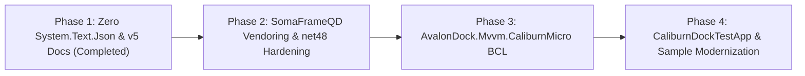

# Roadmap — NTLDR2/AvalonDock Fork

This document tracks the engineering roadmap for **[NTLDR2/AvalonDock](https://github.com/NTLDR2/AvalonDock)** (forked from [Dirkster99/AvalonDock](https://github.com/Dirkster99/AvalonDock)), covering completed foundation work, downstream vendoring into **[NTLDR2/SomaFrameQD](https://github.com/NTLDR2/SomaFrameQD)**, sample application modernization, and the architectural blueprint for a **Caliburn.Micro** Base Class Library / MVVM bridge (`AvalonDock.Mvvm.CaliburnMicro`).

---

## Milestone Overview



| Phase | Focus Area | Status |
|:------|:-----------|:-------|
| **Phase 1** | Surgical removal of `System.Text.Json` packages (`Serializer.Json`, `Themes.VS`, `Themes.VS2013`), 38-page `documentation/` documentation, `AGENTS.md`, and `avalondock-internals` AI skill | **Completed** |
| **Phase 2** | `.NET Framework 4.8` transitive-dependency audit, build/props isolation, and vendored integration into [NTLDR2/SomaFrameQD](https://github.com/NTLDR2/SomaFrameQD) | **Planned (Next)** |
| **Phase 3** | Design & implementation of `AvalonDock.Mvvm.CaliburnMicro` (`netstandard2.0` BCL equivalent to `AvalonDock.Mvvm.CommunityToolkit`) + STA unit tests | **Proposed / Design Ready** |
| **Phase 4** | Modernize dated sample applications—starting with `source/CaliburnDockTestApp` and extending across `source/*Test*` / `AvalonDockCodeApp` | **Planned** |

---

## Non-Negotiable Architectural Guardrails

Every roadmap item in this fork is governed by four permanent constraints:

1. **Zero `System.Text.Json` (Permanent Ban):** No library, bridge package, sample, or test project may directly or transitively reference `System.Text.Json`. Any candidate third-party NuGet dependency must have its `net48` and `netstandard2.0` dependency graph audited before adoption to prevent `System.Memory` / `System.Buffers` / `System.Runtime.CompilerServices.Unsafe` / `Microsoft.Bcl.AsyncInterfaces` DLL hell.
2. **`.NET Framework 4.8` & WPF First:** Every WPF feature, theme dictionary, multi-window mode (`LayoutFloatingWindowControl` and `DetachedAnchorableWindow`), and MVVM bridge must compile cleanly (`--warnaserror`) and pass STA regression tests on `net48` (Windows 7 SP1 64-bit through Windows 11) alongside modern `.NET 8.0`–`11.0-windows`.
3. **Strict `netstandard2.0` UI-Agnostic Boundary:** ViewModel and service libraries (`AvalonDock.Core`, `AvalonDock.Mvvm`, `AvalonDock.Mvvm.CommunityToolkit`, `AvalonDock.Serializer.Xml`, and the planned `AvalonDock.Mvvm.CaliburnMicro`) must remain pure `netstandard2.0` with zero `System.Windows.*` references.
4. **Inside-Out AI-Readable Documentation:** Architectural changes must simultaneously update `documentation/`, [AGENTS.md](AGENTS.md), and [.agents/skills/avalondock-internals/SKILL.md](.agents/skills/avalondock-internals/SKILL.md) so AI coding agents always operate from ground-truth invariants.

---

## Phase 2: Vendoring into `NTLDR2/SomaFrameQD` & `net48` Hardening

The primary operational goal of this fork is to serve as a clean, deterministic vendored dependency inside **[NTLDR2/SomaFrameQD](https://github.com/NTLDR2/SomaFrameQD)**.

### Planned Tasks
- **Vendoring Topology & MSBuild Isolation:**
  - Ensure `source/Directory.Build.props` does not collide with parent-directory `Directory.Build.props` / `Directory.Packages.props` when mounted as a submodule, Git subtree, or `vendor/` source tree inside `SomaFrameQD`.
  - Provide a lightweight MSBuild import or solution filter containing only the shipped `source/Components/*` projects required by `SomaFrameQD` (excluding sample apps and FlaUI harnesses from host builds).
- **`net48` Zero-Transitive-Bloat Audit:**
  - `AvalonDock`, `AvalonDock.Core`, `AvalonDock.Mvvm`, `AvalonDock.Serializer.Xml`, and all 5 `AvalonDock.Themes.*` libraries already compile on `net48` with **zero** external NuGet runtime dependencies (only inbox `.NET Framework 4.8` BCL + WPF assemblies).
  - Document and verify binding-redirect expectations for optional packages (`AvalonDock.DependencyInjection` and `AvalonDock.Mvvm.CommunityToolkit`, which pull `Microsoft.Bcl.AsyncInterfaces` / `System.Memory` on `net48`) so `SomaFrameQD` can stay 100% inbox-only on `net48` whenever desired.
- **Deterministic Layout Persistence Verification:**
  - Lock down XML DTO round-trip tests (`XmlLayoutDtoMapperRoundTripTests`) for `SomaFrameQD`'s workspace layouts, floating windows, detached OS tool windows, and unresolved-pane handling (`UnresolvedContentHandling`).

---

## Phase 3: Caliburn.Micro Bridge / BCL (`AvalonDock.Mvvm.CaliburnMicro`)

### Motivation

Upstream AvalonDock v5 ships two `netstandard2.0` MVVM ViewModel layers:
1. **`AvalonDock.Mvvm`** — zero external dependencies (`DockableBase`, `ToolboxBase`, `DockBase`, `Document`, `Tool`).
2. **`AvalonDock.Mvvm.CommunityToolkit`** — `CommunityToolkit.Mvvm` `ObservableObject`-backed equivalents (`ObservableDockableBase`, `ObservableToolboxBase`, `ObservableDockBase`, `ObservableDocument`, `ObservableTool`) for developers using `[ObservableProperty]` and `[RelayCommand]` source generators.

Developers building WPF applications with **[Caliburn.Micro](https://github.com/NTLDR2/Caliburn.Micro)** currently have no equivalent v5 bridge. Instead, as seen in the legacy `source/CaliburnDockTestApp` sample, Caliburn.Micro users must drop back to v4-style `DocumentsSource="{Binding Items}"` bindings and hand-author XAML `DocumentHeaderTemplate`, `LayoutItemTemplate`, and `LayoutItemContainerStyle` glue—losing automatic access to v5's `IDockLayoutService`, `ToggleDockingManager` 6-zone sidebars (`IToolbox`), `SideToggleManager`, and `[DataContract]` serialization metadata.

Creating **`AvalonDock.Mvvm.CaliburnMicro`** will give Caliburn.Micro developers a first-class Base Class Library (BCL) that feels completely native to both Caliburn.Micro (`Screen`, `PropertyChangedBase`, `Conductor<T>`, `NotifyOfPropertyChange`) and AvalonDock v5 (`IDockable`, `IToolbox`, `IDock`, `IDockLayoutService`).

> [!TIP]
> **AI-Ready Companion Internals Repository ([NTLDR2/Caliburn.Micro](https://github.com/NTLDR2/Caliburn.Micro)):** When implementing `AvalonDock.Mvvm.CaliburnMicro` and modernizing `CaliburnDockTestApp`, consult **[https://github.com/NTLDR2/Caliburn.Micro](https://github.com/NTLDR2/Caliburn.Micro)** alongside this repository's [AGENTS.md](AGENTS.md) and [SKILL.md](.agents/skills/avalondock-internals/SKILL.md). That companion fork provides AI-ready, inside-out documentation of Caliburn.Micro's internal architecture (`PropertyChangedBase`, `Screen` activation/deactivation state machines, `Conductor<T>` collections, `IGuardClose` async close pipelines, `ViewLocator` / `ViewModelBinder` conventions, and `SimpleContainer`).

### Proposed Project & Package Identity

| Attribute | Specification |
|:----------|:--------------|
| **Project Path** | `source/Components/AvalonDock.Mvvm.CaliburnMicro/AvalonDock.Mvvm.CaliburnMicro.csproj` |
| **Root Namespace & Assembly** | `AvalonDock.Mvvm.CaliburnMicro` |
| **Package ID** | `Dirkster.AvalonDock.Mvvm.CaliburnMicro` *(or fork-scoped equivalent)* |
| **Target Framework** | `netstandard2.0` *(strictly UI-agnostic — zero `System.Windows.*` references)* |
| **Dependencies** | `AvalonDock.Core` (`ProjectReference`) + `Caliburn.Micro.Core` (stable `4.0.x`, `netstandard2.0`) |
| **AI Internals Reference** | **[NTLDR2/Caliburn.Micro](https://github.com/NTLDR2/Caliburn.Micro)** *(AI-friendly Caliburn.Micro internals repository)* |
| **`System.Text.Json` Check** | `Caliburn.Micro.Core` (`netstandard2.0`) has **zero** `System.Text.Json` dependencies (must still pass automated lockfile audit on `net48`) |

### 1-to-1 Base Class Parity with `AvalonDock.Mvvm.CommunityToolkit`

`AvalonDock.Mvvm.CaliburnMicro` mirrors the exact class hierarchy of `AvalonDock.Mvvm.CommunityToolkit` (`source/Components/AvalonDock.Mvvm.CommunityToolkit/`):

| Role | `AvalonDock.Mvvm` *(Zero Deps)* | `AvalonDock.Mvvm.CommunityToolkit` | Proposed `AvalonDock.Mvvm.CaliburnMicro` | Core Interface |
|:-----|:--------------------------------|:-----------------------------------|:-----------------------------------------|:---------------|
| **Abstract dockable base** | `DockableBase` | `ObservableDockableBase` (`: ObservableObject`) | **`CaliburnDockableBase`** (`: Screen, IDockable`) | `IDockable` |
| **Abstract toolbox base** | `ToolboxBase` | `ObservableToolboxBase` | **`CaliburnToolboxBase`** (`: CaliburnDockableBase, IToolbox`) | `IToolbox` |
| **Abstract dock container** | `DockBase` | `ObservableDockBase` | **`CaliburnDockBase`** (`: Conductor<IDockable>.Collection.OneActive, IDock`) | `IDock` |
| **Concrete leaf document** | `Document` | `ObservableDocument` | **`CaliburnDocument`** (`: CaliburnDockableBase`) | `IDockable` |
| **Concrete leaf tool** | `Tool` | `ObservableTool` | **`CaliburnTool`** (`: CaliburnDockableBase`) | `IDockable` |

### Target Developer Experience (Sketch)

With `AvalonDock.Mvvm.CaliburnMicro`, a Caliburn.Micro screen participates directly in `ToggleDockingManager` 6-zone sidebars and `IDockLayoutService` while retaining Caliburn's `Set(...)`, `NotifyOfPropertyChange`, `DisplayName`, and `OnActivateAsync` / `CanCloseAsync` lifecycle:

```csharp
using AvalonDock.Core;
using AvalonDock.Mvvm.CaliburnMicro;

public class ExplorerViewModel : CaliburnToolboxBase
{
    private string _filterText = string.Empty;

    public ExplorerViewModel()
    {
        Id = "Explorer";
        DisplayName = "Solution Explorer"; // Automatically aliases IDockable.Title
        Zone = DockZone.LeftTop;
        Shortcut = "Ctrl+Shift+E";
        IsOpenByDefault = true;
    }

    public string FilterText
    {
        get => _filterText;
        set => Set(ref _filterText, value);
    }
}
```

### Key Technical Challenges & Design Reconciliations

Implementing `CaliburnDockableBase : Screen, IDockable` cleanly requires solving five subtle contract differences between `Caliburn.Micro.Core` and `AvalonDock.Core`:

#### 1. Bidirectional `IDockable.Title` ↔ `Screen.DisplayName` Synchronization
- **Mismatch:** Caliburn.Micro conventions, conductors, and window managers bind to `IHaveDisplayName.DisplayName`, whereas `LayoutSyncBridge` and AvalonDock styles bind to `IDockable.Title`.
- **Solution:** Override `DisplayName` on `CaliburnDockableBase` and back `Title` with `DisplayName` (or synchronize both setters) so mutating either property raises `NotifyOfPropertyChange(nameof(DisplayName))` **and** `NotifyOfPropertyChange(nameof(Title))` without re-entrancy loops.

#### 2. `IDockable.IsActive { get; set; }` vs. `Screen.IsActive { get; }` Signature Conflict
- **Mismatch:** `Caliburn.Micro.Screen` implements `IActivate.IsActive` as `public bool IsActive { get; private set; }` (mutated only via `ActivateAsync` / `DeactivateAsync`), whereas `AvalonDock.Core.IDockable` declares `bool IsActive { get; set; }` so `LayoutSyncBridge` can push focus changes onto the ViewModel.
- **Solution:** Keep `Screen.IsActive` intact for Caliburn consumers and implement `bool IDockable.IsActive` explicitly (or route setter transitions through a non-blocking lifecycle adapter that updates active state and invokes `OnSelected()` without corrupting `Screen`'s internal activation flags).

#### 3. Synchronous `IDockable.OnClose()` vs. Asynchronous `IGuardClose.CanCloseAsync`
- **Mismatch:** AvalonDock's `LayoutItem` close command and `DockingManager.DocumentClosing` event evaluate cancellation synchronously on the WPF STA thread (`bool OnClose()`), whereas Caliburn.Micro 4.x uses `Task<bool> CanCloseAsync(CancellationToken)` and `TryCloseAsync`.
- **Solution:**
  - Provide a synchronous virtual guard hook (`protected virtual bool CanCloseSynchronously() => true`) wired to `IDockable.OnClose()` and bridged by default into `CanCloseAsync` (`Task.FromResult(CanCloseSynchronously())`) so standard dirty-document prompts (`IsModified == true`) work identically whether initiated by clicking the AvalonDock tab `X` button or calling Caliburn's `TryCloseAsync()`—**without** calling `.Result` / `.GetAwaiter().GetResult()` on genuinely async UI tasks (which would deadlock the WPF `Dispatcher`).
  - Document the async-close intercept pattern (`DocumentClosing` cancel + `await screen.TryCloseAsync()` + `IDockLayoutService.CloseDocument(doc)`) for apps requiring asynchronous save dialogs.

#### 4. WPF `ViewLocator` (`cal:View.Model`) & Single-Presenter Invariants
- **Context:** In AvalonDock v5, `LayoutItem` (`DataContext = this`, `Model = LayoutElement.Content`) creates a single `ContentPresenter` (`LayoutItem.View`) bound to the ViewModel and `DockingManager.LayoutItemTemplate` (see [SKILL.md](.agents/skills/avalondock-internals/SKILL.md)). Meanwhile, `TabControlEx` caches materialized presenters inside `PART_ItemsHolder` across tab switches, and `DetachedAnchorableWindow` transfers that single `LayoutItem.View` presenter when detaching/re-docking.
- **Solution:** Provide a documented (or optional WPF helper ResourceDictionary) `LayoutItemTemplate` + `LayoutItemContainerStyle` recipe using `<ContentControl cal:View.Model="{Binding}" IsTabStop="False" />` and `<Setter Property="ContentId" Value="{Binding Model.Id}" />`, verified with STA tests across tab switching, tear-off `LayoutFloatingWindowControl`, and standalone `DetachedAnchorableWindow` transitions so `ViewAware` views are not prematurely detached or recreated.

#### 5. IoC Container Agnosticism (`SimpleContainer` & `IServiceCollection`)
- **Solution:** Ensure `CaliburnToolboxBase`, `CaliburnDocument`, and `DockLayoutService` work identically whether composed through Caliburn.Micro's classic `BootstrapperBase` + `SimpleContainer` (`GetAllInstances(typeof(IToolbox))`) or via `AvalonDock.DependencyInjection` (`services.AddDockLayoutService(...)`).

---

## Phase 4: Sample Applications Audit & Modernization (`CaliburnDockTestApp` & Sibling Samples)

> [!IMPORTANT]
> **Audit Note:** Several sample applications under `source/` predate the full AvalonDock v5 architecture and carry dated target frameworks, pre-release packages, or legacy v4 binding boilerplate. Updating them—starting with **`source/CaliburnDockTestApp`**—is an explicit roadmap priority.

### 1. Overhaul `source/CaliburnDockTestApp` *(Priority Sample Update)*
Our audit of `source/CaliburnDockTestApp/` identified the following dated artifacts to clean up alongside Phase 3:
- **Pre-release Package:** Currently references `Caliburn.Micro` `4.0.136-rc` instead of a current stable `4.0.x` release.
- **Obsolete v3.2 Preprocessor Shims:** `MainWindowViewModel.cs` and `ViewModelBase.cs` still contain `#if CALIBURN_ASYNC` / `#else` branches for legacy synchronous Caliburn.Micro 3.2.
- **v4-Era Boilerplate Only:** `MainWindowView.xaml` binds `DocumentsSource="{Binding Items}"` with custom Marlett close buttons and manual `DocumentHeaderTemplate` / `LayoutItemContainerStyle` wiring, without demonstrating `ArcDarkTheme` / `ArcLightTheme`, `ToggleDockingManager` 6-zone toolboxes, `IDockLayoutService`, or `XmlLayoutSerializer`.
- **Dated TFM Matrix:** Currently targets `net9.0-windows;net48`.
- **Planned Modernization:**
  1. Upgrade to stable `Caliburn.Micro` (or vendored source from [NTLDR2/Caliburn.Micro](https://github.com/NTLDR2/Caliburn.Micro), verifying zero `System.Text.Json` transitive dependencies on `net48`).
  2. Remove `#if CALIBURN_ASYNC` legacy shims and local `RelayCommand.cs` boilerplate.
  3. Rebuild the sample around `AvalonDock.Mvvm.CaliburnMicro` (`CaliburnToolboxBase`, `CaliburnDocument`), showcasing `ToggleDockingManager` / `DockingManager`, `ArcDarkTheme` + runtime theme switching, dirty-document close guards, and `XmlLayoutSerializer` round-trip persistence.
  4. Align `<TargetFrameworks>` to prioritize `net48` alongside current `.NET` (`net10.0-windows;net11.0-windows;net48`).

### 2. Audit & Refresh Remaining Sample Projects in `source/`

| Sample Project | Current State Found in Audit | Planned Cleanup |
|:---------------|:-----------------------------|:----------------|
| **`AvalonDockCodeApp`** | Flagship v5 `ToggleDockingManager` IDE demo, currently targeting `net10.0-windows;net11.0-windows` **only** (omits `net48`) | Evaluate adding `net48` support (or a zero-transitive-dep `AvalonDock.Mvvm` `net48` variant) so the flagship demo runs directly on `.NET Framework 4.8` |
| **`MVVMTestApp`** | Classic `DocumentsSource` / `AnchorablesSource` + `XmlLayoutSerializer` sample targeting `net9.0-windows;net48` | Align TFMs (`net10.0-windows;net11.0-windows;net48`) and include `ArcDarkTheme` / `ArcLightTheme` in its theme switcher |
| **`WinFormsTestApp`** | `ElementHost` / `WindowsFormsHost` airspace interop test targeting `net9.0-windows;net48` | Align TFMs with current test matrix and verify `net48` interop focus behavior |
| **`MLibTest`** | Targets `net9.0-windows;net48`, retains dead MSBuild conditions (`net5.0-windows`, `netcoreapp3.0`, `net40`), and references non-SDK `Settings.csproj` (`v4.5.2`) | Prune dead pre-v5 MSBuild conditions and upgrade or retire legacy `v4.5.2` helper project |
| **`AvalonDocPanelMemoryLeaks`** | Legacy non-SDK `.csproj` targeting `.NET Framework v4.6.1` | Migrate leak regression scenarios into `AvalonDockTest` (`net48` + modern `.NET`) or convert to SDK-style `net48` |
